# Search architecture

<!-- Generated from apps/mcp/src/search/config/searchConfig.json by node scripts/tex-architecture.mjs; edit the config (or the Lab's Search page), never this page. -->

Search's own config (Dev2, 2026-11-21: "not only Tex uses search"): every step a search runs, its settings and the wires between them. Read by the gateway's search for every caller (an AI client's search_notes, the app's search bar, Tex) through searchConfig.cjs, and edited in the Lab on the Search page. A Lab Promote changes this file in a pull request.

**Who runs it.** The gateway's search, for every caller (an AI client's search_notes, the app's search bar, Tex): findNotes in apps/mcp/src/tools/search.js runs its steps (apps/mcp/src/search/config/nodes.js) on the shared graph runner.

## Drawing

```mermaid
flowchart LR
  n_search(["Query<br/>code<br/>apps/mcp/src/search/config/nodes.js"]):::start
  n_open["Open as you<br/>code<br/>apps/mcp/src/search/config/nodes.js · privacy/state.js"]:::code
  n_words["Words<br/>code<br/>apps/mcp/src/search/visibleNotes.js · objectSearch.js"]:::code
  n_rerankWords["Rerank word hits<br/>code<br/>apps/mcp/src/search/rerank.js"]:::code
  n_meaning["Meaning<br/>code<br/>apps/mcp/src/search/meaning/serve.js meaningMatches"]:::code
  n_visible["Only what you may see<br/>code<br/>apps/mcp/src/search/config/nodes.js visibleStep"]:::code
  n_probes["Drop search probes<br/>code<br/>apps/mcp/src/search/stages.js dropProbes"]:::code
  n_floor["Close meaning only<br/>code<br/>apps/mcp/src/search/stages.js closeMeaning"]:::code
  n_merge["Merge<br/>code<br/>apps/mcp/src/search/stages.js mergeLists"]:::code
  n_title["Title and phrase<br/>code<br/>apps/mcp/src/search/stages.js addEvidence · evidence.js"]:::code
  n_prior["Lower logs and archive<br/>code<br/>apps/mcp/src/search/stages.js lowerByPath · priors.js"]:::code
  n_budget["Meaning-only budget<br/>code<br/>apps/mcp/src/search/stages.js meaningBudget"]:::code
  n_snippets["Read snippets<br/>code<br/>apps/mcp/src/search/meaning/serve.js readMeaningOnly"]:::code
  n_rerank["Rerank<br/>code<br/>apps/mcp/src/search/rerank.js"]:::code
  n_code["Drop code passages<br/>code<br/>apps/mcp/src/search/stages.js answerHits"]:::code
  n_fuse["Merge across workspaces<br/>code<br/>apps/mcp/src/search/config/nodes.js · tools/search.js"]:::code
  n_answer["Answer<br/>code<br/>apps/mcp/src/search/config/nodes.js answerStep"]:::code
  n_search -->|open| n_open
  n_open --> n_words
  n_open --> n_meaning
  n_words --> n_rerankWords
  n_rerankWords --> n_visible
  n_meaning --> n_visible
  n_visible --> n_probes
  n_probes --> n_floor
  n_floor --> n_merge
  n_merge --> n_title
  n_title --> n_prior
  n_prior --> n_budget
  n_budget --> n_snippets
  n_snippets --> n_rerank
  n_rerank --> n_code
  n_code -->|several| n_fuse
  n_code -->|one| n_answer
  n_fuse --> n_answer
  classDef start fill:#ffe3ee,stroke:#ff4f8b,color:#1d1838
  classDef code fill:#dcf7f3,stroke:#11b5a4,color:#1d1838
  classDef model fill:#ece5ff,stroke:#7b4dff,color:#1d1838
  classDef tool fill:#fff0e2,stroke:#ff8a2a,color:#1d1838
  classDef off fill:#eeeeee,stroke:#999999,color:#555555,stroke-dasharray:4 3
```

## Steps

| Step | Goal | Code |
|---|---|---|
| Query | A search arrives (an AI client's search_notes, the app's search bar, Tex): pick the workspaces it asks, every one the person reaches unless a folder, a scope or the person's setting narrows it. | apps/mcp/src/search/config/nodes.js |
| Open as you | Open every workspace asked the way a tool call naming it does: the person's role there and its own privacy rules. One that cannot be opened now is left out and named unreached, never guessed at. | apps/mcp/src/search/config/nodes.js · privacy/state.js |
| Words | Nominates: notes holding the query's words in every workspace at once, ranked by the word index (BM25, titles and headings weighted), retried with any word when no note holds them all (those are marked loose). Only notes the person may see. | apps/mcp/src/search/visibleNotes.js · objectSearch.js |
| Rerank word hits | Ranks: each workspace’s first word hits (rerankTop, rerankChars of each) read beside the query by the cross-encoder in one call as soon as Words answers, while Meaning still runs, so its time hides behind Meaning’s; each hit keeps its score for Rerank, which then reads it no more. Never adds or drops a note. Off on main until a Lab draft shows it helps. | apps/mcp/src/search/rerank.js |
| Meaning | Nominates: the nearest passages to the query's embedding (embedded once per search) in every workspace at once, at least minScore close. Only notes the person may see; never plumbing or a search probe. | apps/mcp/src/search/meaning/serve.js meaningMatches |
| Only what you may see | Filters: both lists side by side per workspace, every note checked once more against the person's access there. A workspace whose word search failed is left out and named unreached. | apps/mcp/src/search/config/nodes.js visibleStep |
| Drop search probes | Filters: a benchmark's search-probe note is never an answer. | apps/mcp/src/search/stages.js dropProbes |
| Close meaning only | Filters: once the words found a note with every word, a note only meaning found must be at least meaningFloor close. | apps/mcp/src/search/stages.js closeMeaning |
| Merge | Merges: one row per note from the word list and the meaning list, each adding 1 / (rrfK + rank + 1), so a note both find rises. A hit whose words sit only in a link counts as loose, and loose hits go last. No merge when meaning found nothing: the word hits stand as they are. | apps/mcp/src/search/stages.js mergeLists |
| Title and phrase | Ranks: a word hit gains titleWeight for each share of the query's terms its title or file name holds, and phraseBonus when the whole query is a phrase in its title or file name (snippetPhraseBonus when only in its text). Only when one workspace is searched; across several, Merge across workspaces does it. | apps/mcp/src/search/stages.js addEvidence · evidence.js |
| Lower logs and archive | Ranks: an archived note or a log (Inbox captures, Tex's own logs, review logs, retired setups) scores logPrior of a live note with the same evidence. A note still unfiled in the Inbox scores inboxPrior. | apps/mcp/src/search/stages.js lowerByPath · priors.js |
| Meaning-only budget | Filters: every word hit stays; of the notes only meaning found, the best extraNotes (looseReads when no note held every word). | apps/mcp/src/search/stages.js meaningBudget |
| Read snippets | Each kept note only meaning found is read for its title and the passage that matched, snippetChars long, all at once. | apps/mcp/src/search/meaning/serve.js readMeaningOnly |
| Rerank | Ranks: each workspace’s first rows (rerankTop, rerankChars of each) read beside the query by a cross-encoder, every workspace in one call; a row Rerank word hits already scored is not read again, and with readLate 0 the rest keep their places unread (no call here). Each adds a part for its place (rerankWeight, as one more reciprocal-rank list, under the path prior) and keeps the model’s score, which Rank across workspaces ranks together. Never adds or drops a note. Off on main until a Lab draft shows it helps. | apps/mcp/src/search/rerank.js |
| Drop code passages | Filters: a code passage found only by meaning is not offered for a question in prose (one workspace; across several, Merge across workspaces does it), and a note that could not be read is dropped. | apps/mcp/src/search/stages.js answerHits |
| Merge across workspaces | Merges and ranks when several workspaces answered: one list ranked by evidence rather than by workspace: word rank (a loose hit counted lower), rank among every meaning match, title and phrase evidence, the path prior and a named workspace's boost; the meaning-only budget once for the whole answer; at most hits shown. | apps/mcp/src/search/config/nodes.js · tools/search.js |
| Answer | The fused list across workspaces, or the one workspace's, with who answered and who could not be reached. | apps/mcp/src/search/config/nodes.js answerStep |

## Settings

| Step | Setting | Value |
|---|---|---|
| Rerank word hits | `rerankTop` | 8 |
| Rerank word hits | `rerankChars` | 400 |
| Meaning | `minScore` | 0.4 |
| Close meaning only | `meaningFloor` | 0.5 |
| Merge | `rrfK` | 60 |
| Title and phrase | `phraseBonus` | 0.00819672131147541 |
| Title and phrase | `snippetPhraseBonus` | 0 |
| Title and phrase | `titleWeight` | 0.003278688524590164 |
| Lower logs and archive | `inboxPrior` | 0.5 |
| Lower logs and archive | `logPrior` | 0.5 |
| Meaning-only budget | `extraNotes` | 3 |
| Meaning-only budget | `looseReads` | 6 |
| Read snippets | `snippetChars` | 200 |
| Rerank | `readLate` | 0 |
| Rerank | `rerankChars` | 400 |
| Rerank | `rerankTop` | 8 |
| Rerank | `rerankWeight` | 1 |
| Merge across workspaces | `boostFactor` | 1.2 |
| Merge across workspaces | `hits` | 12 |
| Merge across workspaces | `inboxPrior` | 0.5 |
| Merge across workspaces | `logPrior` | 0.5 |
| Merge across workspaces | `loosePenalty` | 10 |
| Merge across workspaces | `looseReads` | 6 |
| Merge across workspaces | `meaningFloor` | 0.5 |
| Merge across workspaces | `phraseBonus` | 0.00819672131147541 |
| Merge across workspaces | `rrfK` | 60 |
| Merge across workspaces | `snippetPhraseBonus` | 0 |
| Merge across workspaces | `titleWeight` | 0.003278688524590164 |
| Merge across workspaces | `rerankWeight` | 1 |
