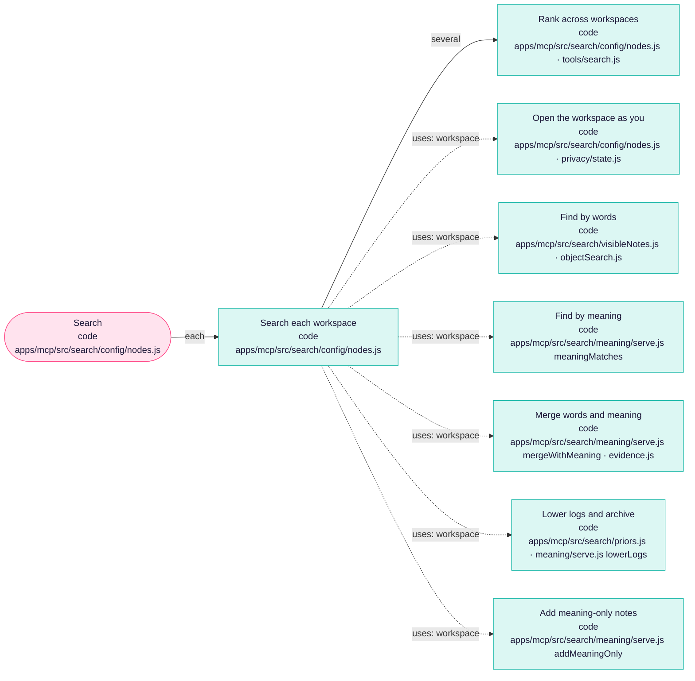

# Search architecture

<!-- Generated from apps/mcp/src/search/config/searchConfig.json by node scripts/tex-architecture.mjs; edit the config (or the Lab's Search page), never this page. -->

Search's own config (Dev2, 2026-11-21: "not only Tex uses search"): every step a search runs, its settings and the wires between them. Read by the gateway's search for every caller (an AI client's search_notes, the app's search bar, Tex) through searchConfig.cjs, and edited in the Lab on the Search page. A Lab Promote changes this file in a pull request.

**Who runs it.** The gateway's search, for every caller (an AI client's search_notes, the app's search bar, Tex): findNotes in apps/mcp/src/tools/search.js runs its steps (apps/mcp/src/search/config/nodes.js) on the shared graph runner.

## Drawing

## Steps

| Step | Goal | Code |
|---|---|---|
| Search | A search arrives (an AI client's search_notes, the app's search bar, Tex): pick the workspaces it asks, every one the person reaches unless a folder, a scope or the person's setting narrows it. | apps/mcp/src/search/config/nodes.js |
| Search each workspace | Every workspace asked, at once: in each it opens the workspace as the person, finds notes by words and by meaning side by side, merges the two lists, lowers logs and archive, and adds the closest notes only meaning found. Each of those is its own step below, run once per workspace. | apps/mcp/src/search/config/nodes.js |
| Open the workspace as you | Open one workspace the way a tool call naming it does: the person's role there and its own privacy rules, which every later step checks each note against (canSee). One that cannot be opened or read now is left out and named unreached, never guessed at. | apps/mcp/src/search/config/nodes.js · privacy/state.js |
| Find by words | The word index: notes holding the query's words, ranked by BM25 with titles and headings weighted, retried with any word when no note holds them all (those hits are marked loose). Only notes the person may see; the path it took (object, database, index or scan) is logged. | apps/mcp/src/search/visibleNotes.js · objectSearch.js |
| Find by meaning | Embed the query (once per search, shared by every workspace) and find the nearest passages in the workspace's meaning index, at least minScore close. Only notes the person may see, never a log of the plumbing or a search probe. | apps/mcp/src/search/meaning/serve.js meaningMatches |
| Merge words and meaning | One list from the two by reciprocal rank (rrfK), a note both find rising. A note only meaning found joins only when close (meaningFloor) once the words found a note with every word; a word hit adds its title (titleWeight) and phrase (phraseBonus) evidence; a hit whose words sit only in a link counts as loose, and loose hits go last. | apps/mcp/src/search/meaning/serve.js mergeWithMeaning · evidence.js |
| Lower logs and archive | Scale each merged score by where the note lives: an archived note, a log (Inbox captures of messages, email, calendar, Tex's own logs, review logs, retired setups) scores logPrior of a live note with the same evidence. It only reorders. | apps/mcp/src/search/priors.js · meaning/serve.js lowerLogs |
| Add meaning-only notes | Read a snippet for the closest notes only meaning found, at most extraNotes of them (looseReads when no note held every word), snippetChars long; a passage of code is not offered for a question in prose. Answers the workspace's hits, each with its evidence for ranking across workspaces. | apps/mcp/src/search/meaning/serve.js addMeaningOnly |
| Rank across workspaces | One list from every workspace's, ranked by evidence rather than by workspace: word rank (a loose hit counted lower), rank among every meaning match, title and phrase evidence, the path prior and a named workspace's boost; at most the hits setting shown. | apps/mcp/src/search/config/nodes.js · tools/search.js |

## Settings

| Step | Setting | Value |
|---|---|---|
| Find by meaning | `minScore` | 0.4 |
| Merge words and meaning | `meaningFloor` | 0.5 |
| Merge words and meaning | `phraseBonus` | 0.00819672131147541 |
| Merge words and meaning | `rrfK` | 60 |
| Merge words and meaning | `snippetPhraseBonus` | 0 |
| Merge words and meaning | `titleWeight` | 0.003278688524590164 |
| Lower logs and archive | `inboxPrior` | 0.5 |
| Lower logs and archive | `logPrior` | 0.5 |
| Add meaning-only notes | `extraNotes` | 3 |
| Add meaning-only notes | `snippetChars` | 200 |
| Add meaning-only notes | `looseReads` | 6 |
| Rank across workspaces | `boostFactor` | 1.2 |
| Rank across workspaces | `hits` | 12 |
| Rank across workspaces | `inboxPrior` | 0.5 |
| Rank across workspaces | `logPrior` | 0.5 |
| Rank across workspaces | `loosePenalty` | 10 |
| Rank across workspaces | `looseReads` | 6 |
| Rank across workspaces | `meaningFloor` | 0.5 |
| Rank across workspaces | `phraseBonus` | 0.00819672131147541 |
| Rank across workspaces | `rrfK` | 60 |
| Rank across workspaces | `snippetPhraseBonus` | 0 |
| Rank across workspaces | `titleWeight` | 0.003278688524590164 |
