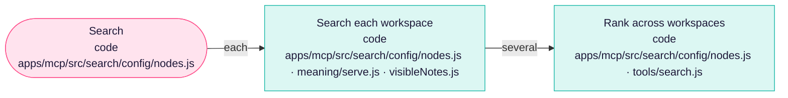

# Search architecture

<!-- Generated from apps/mcp/src/search/config/searchConfig.json by node scripts/tex-architecture.mjs; edit the config (or the Lab's Search page), never this page. -->

Search's own config (Dev2, 2026-11-21: "not only Tex uses search"): every step a search runs, its settings and the wires between them. Read by the gateway's search for every caller (an AI client's search_notes, the app's search bar, Tex) through searchConfig.cjs, and edited in the Lab on the Search page. A Lab Promote changes this file in a pull request.

**Who runs it.** The gateway's search, for every caller (an AI client's search_notes, the app's search bar, Tex): findNotes in apps/mcp/src/tools/search.js runs its steps (apps/mcp/src/search/config/nodes.js) on the shared graph runner.

## Drawing

## Steps

| Step | Goal | Code |
|---|---|---|
| Search | A search arrives (an AI client's search_notes, the app's search bar, Tex): pick the workspaces it asks, every one the person reaches unless a folder, a scope or the person's setting narrows it. | apps/mcp/src/search/config/nodes.js |
| Search each workspace | In every workspace asked, at once and under the person's role there: find notes by their words and by their meaning, and merge the two lists by reciprocal rank, title and phrase evidence and the path prior. | apps/mcp/src/search/config/nodes.js · meaning/serve.js · visibleNotes.js |
| Rank across workspaces | One list from every workspace's, ranked by evidence rather than by workspace: word rank (a loose hit counted lower), rank among every meaning match, title and phrase evidence, the path prior and a named workspace's boost; at most the hits setting shown. | apps/mcp/src/search/config/nodes.js · tools/search.js |

## Settings

| Step | Setting | Value |
|---|---|---|
| Search each workspace | `minScore` | 0.4 |
| Search each workspace | `extraNotes` | 3 |
| Search each workspace | `snippetChars` | 200 |
| Search each workspace | `looseReads` | 6 |
| Search each workspace | `meaningFloor` | 0.5 |
| Search each workspace | `rrfK` | 60 |
| Search each workspace | `titleWeight` | 0.003278688524590164 |
| Search each workspace | `phraseBonus` | 0.00819672131147541 |
| Search each workspace | `logPrior` | 0.5 |
| Rank across workspaces | `hits` | 12 |
| Rank across workspaces | `rrfK` | 60 |
| Rank across workspaces | `loosePenalty` | 10 |
| Rank across workspaces | `titleWeight` | 0.003278688524590164 |
| Rank across workspaces | `phraseBonus` | 0.00819672131147541 |
| Rank across workspaces | `meaningFloor` | 0.5 |
| Rank across workspaces | `looseReads` | 6 |
| Rank across workspaces | `boostFactor` | 1.2 |
| Rank across workspaces | `logPrior` | 0.5 |
