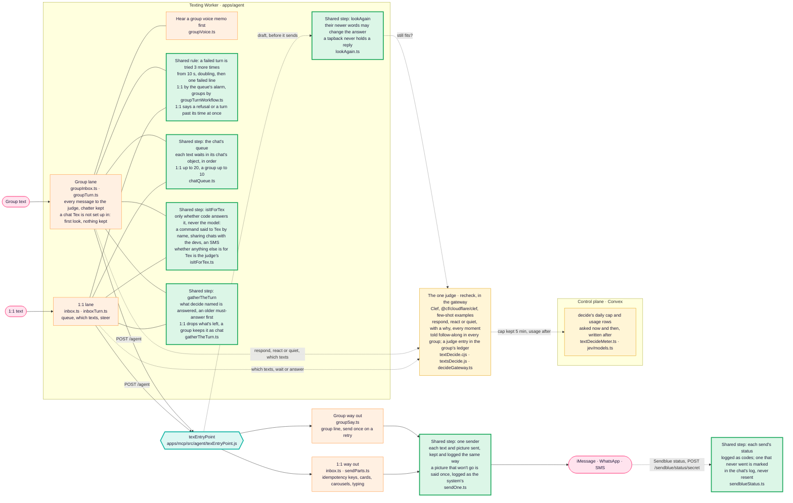
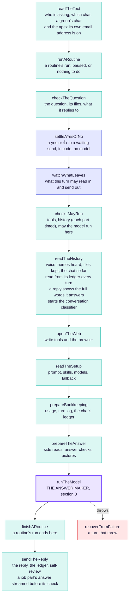
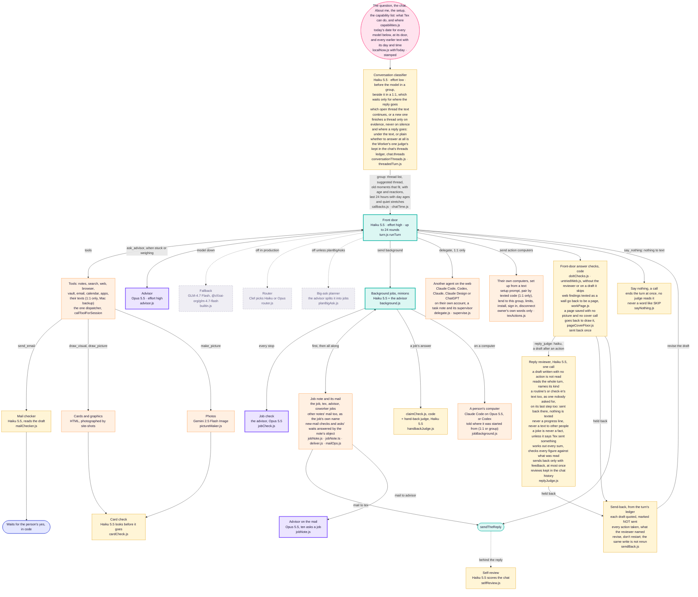

# How Tex works

The one architecture diagram of Tex: how a text reaches `texEntryPoint`, the
steps it runs, and the answer maker inside it with every model it calls.
**Any change to this architecture changes this file in the same pull request**
(Dev2, 2026-11-05: "have a standing rule that any change to the architecture
must change the diagram, that way I can always go to the diagram and see what
changed"). `scripts/tex-diagram-check.mjs` enforces it in CI; see
[the rule](#the-rule) at the bottom. What changed, and when, is the
[change log](#change-log) and this file's history.

Models named here are the production setup's
(`@context-lc ai/production/texting-assistant.md`, read on every turn by
`readTheSetup`) or the literal in the file named beside them.

## 1. A text on its way to the door

Every text, 1:1 or group, ends in the same `texEntryPoint`. What differs today
is the texting Worker in front of it (`apps/agent`), which has a lane for each.
The one-door plan folds the group lane into the door, step by step.



Green boxes are door steps both lanes already share. Each one-door pull
request moves another job out of the two lanes into one.

## 2. The door: texEntryPoint, top to bottom

One function (`apps/mcp/src/agent/texEntryPoint.js`), one file per step under
`apps/mcp/src/agent/texEntryPoint/`. A step either hands the turn on or answers
it; the first answer is the response. Every 1:1 text, group turn, background
job, job report and routine run takes this path.

<!-- tex-diagram: steps begin -->

<!-- tex-diagram: steps end -->

Blue steps are rails kept in code, never by a model: who may say yes, and what
may leave the turn (`privacy/egress.js`).

## 3. The answer maker: runTheModel and every model it calls



Grey dashed boxes are built but off in production today. Other models on the
way: voice memos are heard by Whisper in the transcribe Worker
(`ingestion/transcription.js`), and search by meaning uses BGE-M3 embeddings
(`search/meaning/embed.js`). Decide's Clef is in section 1, asked in the
gateway (`textsDecide.js`) through `decide.js`, the gateway's one call to it;
its cap and usage rows stay in the control plane.
What each model costs is `jev/meter.ts`.

## The rule

1. **A pull request that changes Tex's architecture changes this file.** That
   covers a step added, removed, renamed or reordered in `texEntryPoint`; a
   model, judge or check added, removed, switched on or off; a lane, queue or
   sender in the Worker; and anything this file names moving. Redraw the part
   that changed and add a line to the change log.
2. **CI checks it** (`scripts/tex-diagram-check.mjs`, in Fast repository
   guards):
   - every step `texEntryPoint.js` runs is drawn in section 2, in its order;
   - every file under `apps/mcp/src/agent/`, `apps/agent/src/` or
     `apps/convex/functions/lib/jev/` that names a model is named here;
   - a pull request that changes `texEntryPoint.js`, a file under
     `texEntryPoint/`, or any file this page names in backticks must change
     this page, or say why not in its description with a line
     `Tex diagram: unchanged because <reason>` (a fix inside a file that
     leaves the shape as drawn).

3. **Every Tex agent reads sections 1 to 3.** They are generated into
   `apps/mcp/src/agent/texArchitecture.generated.js` and put ahead of each
   agent's own prompt with one line naming its box (`texArchitecture.js`).
   After redrawing, run `node scripts/tex-architecture-module.mjs`; CI fails
   while the module is stale, and fails any file under `apps/mcp/src/agent/`
   that gives a model a system prompt without `withArchitecture`.

## Change log
Newest first. One line per pull request that changed the drawing.

- 2026-11-12: a group turn is told who is in the chat, the whole list read from the chat each turn: every linked Context account by handle and name, everyone else by guest label (never a number), and how many (`groupNames.js` `rosterLine`, in shared and guest chats); a guest's name goes in the chat's about note once someone there says it. The Worker's control-plane parser had dropped each account's name, and a home-only chat sent none (`groupControl.ts`, `textGroupHomeOnly.ts`). No box changes. Test: `apps/mcp/test/groupNames.test.mjs`.
- 2026-11-11: simple asks answered faster (Dev2's one-judge design, PR 3). The reply reviewer reads only a draft written after an action (a search, read, write or send), and sends it back at most once (it was twice); a draft with no action gets the code checks a setup without the reviewer runs (`doItChecks.js`, `untriedWeb.js`, `claimCheck.js`). No reviewer reads a progress line. A 1:1 turn no longer waits for the conversation classifier before the model: it runs beside it, its verdict is kept and places the reply, and the 1:1 model reads the chat as the log shows it, without the thread list or `read_thread`; a group still waits for it (`replyJudge.js`, `progress.js`, `runTheModel.js`). Bench: `pnpm ai steps` tables where a run's time went, a real run reads the chat's ledger as production does, and `tests/simple-asks.md` is the speed bar. Decision: `docs/decisions/texting-assistant/one-judge-one-record.md`.
- 2026-11-11: one judge (Dev2's one-judge design, PR 1): Clef with labelled few-shot examples (`textDecide.cjs` `JUDGE_EXAMPLES`, in `<examples><example>` tags) decides respond, react or quiet, with a why from a fixed set, for every group message that is not code's, whatever the speak-up setting, which it reads; the gateway keeps each group verdict as a `judge` entry (`by: "moment"`) in the chat's ledger (`textsDecide.js`). Deleted: the word rails (`addressesTex`, `namesTex`, the asker's bare-yes routing `ANSWERS_ASK`, the style gate `reachesDecide`/`styleReaches` and its follow-along counter), decide beside an addressed turn (`decideBeside`), and the Haiku respond classifier with code's floor (`respond.js`, `mayHush`, `hushedTurn`); the conversation classifier only sorts threads and places a reply. A chat Tex is not set up in keeps nothing: its messages wait unlogged for the judge's first look at those lines alone (`firstLook`), and only an answered one is logged. A command still needs Tex's name first (`commandTo`). The judge down (past its time, failed or capped), a waiting question or a message that tags or names Tex is answered (`judgeDownAnswer`). Bench: `pnpm ai respond` scores the judge on held-out cases, with a must-pass "@Tex" set. Decision: `docs/decisions/texting-assistant/one-judge-one-record.md`.
- 2026-11-11: group time awareness (Dev2, plan v3 steps 2 to 4: "the right context, then let Tex choose"). The threaded history gives each day its age ("Nov 7 (4 days ago)") and marks a quiet stretch of four hours or more where it happened; in a group, texts older than the last 24 hours that no conversation holds leave the word-for-word transcript (before, they were kept at any age: the Tex Devs OAuth roast), unless one is an unanswered ask of Tex, and instead up to five older moments that fit what's said now are offered just before the last day's texts, each with who, when and how the chat took it (tapbacks, laughs, replies), ranked by shared rare words, people named, the suggested conversation, reactions and age, with one Tex already brought back this week counting half; Tex chooses freely (`callbacks.js`, `threadedTurn.js`, `logRender.js`). The person's turn says when the chat was quiet before this text, and when a text replies to one from hours or days ago (`chatTime.js`, `runTheModel.js` `turnNote`). Code only, no model call; matching words, not embeddings, until the bench shows a miss. Test: `apps/mcp/test/groupTime.test.mjs`.
- 2026-11-10: the stretch's carried calls replay in production (owner-approved fix of #3156, which replayed nothing): a group reply is no longer stubbed as outside for being a chat's own words, since replies now record `outside` beside `clean` (`sendTheReply.js`, `ledgerConversation.js`); a 1:1 text keys its carried results on the person, workspace and scopes (`stretch.js` `carryKey`), not the per-text token's grant id; and a result read from outside (a page, a listing, a kept file, a job's report) is replayed, not stubbed, and marks the new turn untrusted as if it had read it itself (`readTheHistory.js`). Each turn logs `tex_carry` (carried, stubbed by reason, whether carried outside content marked it, stretch size), also on the `turn_stages` line (`turnStages.js`). No box changes. Test: `apps/mcp/test/texCarryGating.test.mjs`.
- 2026-11-11: a job's start or restart texts nothing; the text that asked gets a tapback and they hear only the result (Dev2: "No one actually cares"), and `start_background_job` always starts a new job with its brief, never picking up a stopped job named like it (a stuck job's report turn added the missing link three times, each dropped, each texting "On it: picking … back up"). A quiet group turn still starts its jobs (`groupModelTurn.ts`). No box changes. Decision: `docs/decisions/texting-assistant/background-jobs.md`.
- 2026-11-10: work Tex looked up on the web (search, a site opened, the browser) and answered as a wall of findings (over 110 words, or four list lines) is sent back once to be a page from a template, with one line and the link texted (owner: pages are "the default for all work output done through Tex"); a quick answer, a turn that only read their notes, one that already made a page or picture, words to copy, or one they asked to have as a text goes as it is (`workPage.js`, in `replyChecks.js`). Test: `apps/mcp/test/agentWorkPage.test.mjs`.
- 2026-11-10: the capability list gains a Pages line: Tex writes a page from one of six templates (`orient about: "template <name>"`) or one of theirs in `tex/templates/` (a shared workspace's `templates/`), and keeps a page as a template when asked; the page skill names them (`capabilities.js`, `pageSkill.js`, `packages/shared/src/pages/templates.cjs`). No box changes.
- 2026-11-10: a text carries the tool calls and results of the chat's current stretch (texts with no gap over an hour, the cache's life; owner-approved 80/20 step 4): each earlier turn of the stretch is replayed as messages, their words, Tex's `tool_use`, the `tool_result`, then its reply, after the rendered log, which now leaves the stretch out and so holds still from text to text and takes the hour mark again (`stretch.js`, `loggedTurn.js`, `threadedTurn.js`, `turn.js`). After an hour quiet the chat is words only. Results of a turn that read from outside, another group member's reads, another workspace's and any read under a grant other than this turn's are stubbed, arguments and all. Old results are cleared server-side by context editing (`clear_tool_uses_20250919`, beta `context-management-2025-06-27`), dropped for the isolate after a 400 naming it (`aiGateway.js`). Thinking is not carried yet. No box changes. Test: `apps/mcp/test/texCarry.test.mjs`.
- 2026-11-10: the cached prefix stays the same from one text to the next (Dev2, so the one-hour cache is read across texts): every background job tool is offered every text and one with nothing to act on is refused in code (`background.js`); who tagged a group, the thread a text was typed in, the jobs running now, whether their computers are online and the calendar copy's age are said in the person's turn, no longer in `system.context` (`runTheModel.js`, `turnPrompt.js`, `groupTurn.js`, `calendarCache.js`); a rendered chat log, rebuilt every text, no longer takes the history's hour mark (`turn.js`). No box changes. Test: `apps/mcp/test/texStablePrefix.test.mjs`.
- 2026-11-10: a tapback only in place of a text (Dev2: "Tex spams and uses emojis way too much"): the Worker no longer taps a working-on-it emoji on a text it is answering (a group tag, or a 1:1 turn past 10 s; the 1:1 keeps its typing bubble), and decide's emoji goes only with react, never beside an answer or a wait. A job's start is one short line ("On it: <title>.") with no live link or card and no promise to text back; the live view goes when they ask what Tex is working on. No box changes. Decision: `docs/decisions/texting-assistant/conversation-threads.md`.
- 2026-11-10: the conversation classifier also says whether Tex answers at all (Dev2: "the thread classifier could probably do this for us, have an output based on examples that's a 'no response'"): reply, react (a tapback, no text) or quiet, learned from labelled examples taken from real chats, and for a reply whether it goes under the text it answers or plain in the chat. React and quiet end the turn before the model runs, kept in the history as a say_nothing with the classifier's reason, unless code's floor holds the text for the model (a question in a 1:1 or typed under a text of Tex's, a group text naming Tex, a text straight after Tex asked something, a tapback, a file in a 1:1). The Worker sends the tapback, and places the reply as told: in a 1:1 in place of the quiet-spell guess, in a group in place of always under the message; a text typed under another is still answered under it. Bench: `pnpm ai respond` (`bench/respond/`). Decision: `docs/decisions/texting-assistant/conversation-threads.md`.
- 2026-11-10: every model Tex calls is told today's date and time at the door (`withToday` in `requestViaGateway` and `requestBuiltin`; Dev2: "Agents should ALWAYS know today's date"), and every earlier text a model reads carries its day and time: a turn's history, the check-in's last texts, the reviewer's, the planner's, `earlier_texts`, and a threaded chat's lines (date, not the weekday alone). The reviewer is told the day itself (it took Monday, November 9 for Tuesday, October 27). Since 2026-11-11 only the gateway's own notice channel — the question message's `preamble`, or a caller saying `toldNow` — can say the day was already told, so text somebody else wrote cannot suppress it. A check-in keeps, above its text, the text it went under, its last thinking and its day's log, so a later turn can say why it texted (`checkInTexts.js` `checkInAbout`). Decision: `docs/decisions/texting-assistant/dates-everywhere.md`.
- 2026-11-10: the Pages line adds a page's own layout: a ```` ```layout ```` fence of HTML and CSS that places the page's sections by `data-from`, refused at write if it runs or loads anything (`packages/shared/src/pages/layout.cjs`) and cleaned again in the frame (`apps/mobile/page-frame/layout.js`). No box changes.
- 2026-11-10: a page saved with no picture of any kind (no photo, no image, no map, no drawing) and no cover call after it is sent back once to make the cover call, which draws its picture (owner: "WE NEED TO MAKE VISUAL PAGES"; a job had skipped it as "optional"). The page-photo hunt also covers people and named timeline rows, and a bare web address in a page is a link (`pageCoverFloor.js` in `replyChecks.js`, `visuals/pagePhotos.js`). Test: `apps/mcp/test/pageVisual.test.mjs`.
- 2026-11-10: a note's date properties fill themselves, and the owner can fill the empty ones once with `manage.fill_dates`; the capability list names it. No box changes.
- 2026-11-09: the old history record is retired: nothing reads or writes it. A turn reads its chat from the ledger alone, marked as copied in or not (`ledgerConversation.js`), and sendTheReply no longer appends to the record. Nothing drawn changes: every reader already read the ledger.
- 2026-11-09: a routine's run or a check-in that reaches its last steps is told silence is the answer when nothing is for the person (never to write a note it can't, never to answer in words), and the reply reviewer reads its last answer too; one sent back there is not texted (`lastRound.js`, `turn.js`). A job's report, which answers no text of theirs, stays in the chat a routine reads, as Tex's own text (`ledgerConversation.js`): an hourly routine ran on after its job had texted that the work was done.
- 2026-11-08: a group chat has its own email address, `group-<its home's three words>@context.lc`: anyone may send or forward to it, each email is filed as a note in the home's `email/` (the email Worker, `groupMailIngest.ts`), a capture brings the chat's check-in forward (a chat that reaches no workspace looks in its home), the check-in reads that mail, and a group turn is told the address and where its mail is (`readTheText.js`, `chatHome.js`, `groupRoutines.ts`). Receive only: nothing is sent from the address.
- 2026-11-08: the housekeeping and overnight About me switches are also on the Tex page's Check-ins, for a person's own Tex (`switch.set`, `http/texPage/notes.js`); the capability list names them. No box changes.
- 2026-11-08: a job's part no longer runs again from nothing when the gateway fails after it answered (Dev2, "All three"): `sendTheReply` streams the part's answer as an `answered` line before the advisor's check (`answer_early`, `progress.js`), and the Worker keeps it if the stream then dies or ends failed (`clients.ts`); a part cut off before any answer hands its streamed steps to the next part, which reads them back first (`cutOff`, `jobRun.ts`, `background.js`); the Worker logs why each part carried on; the gateway's own log lines go to Workers Logs (`wrangler.toml` `[observability]`, invocation lines off).
- 2026-11-08: overlapping turns no longer cut each other off: a group chat's grant (and its home-only one) keeps a token a newer mint replaced until that token's own expiry, as a 1:1 texting grant already did (`earlierTokens.ts`, `liveGrants.ts`), so a person's job pass, its report and their next tag run at once; a job's report refused a model in a group is tried again on a fresh grant like any failed turn, and refused every time, or out of the day's background turns, the chat hears there is news, never silence (`groupModelTurn.ts`, `groupInbox.ts`). No box changes.
- 2026-11-08: Tex sets up a person's own computers itself instead of sending them to buttons (Dev2): `send` action `computers` hands the coding-agent setup prompt, approves a pairing code texted in their own 1:1, lends a computer to the group chat it's asked in (who, Ask me first), renames it, sets limits and more time, installs and signs in Claude Code or Codex, and disconnects it, each on the owner's own words (`texActions.js`, `setupPrompt.js`, `runTheModel.js`).
- 2026-11-08: one capability list (Dev2, "One capability list everywhere"): every line of what Tex can do, in a 1:1 text, a group chat and a guest chat, with who asks, drafts and approves, goes with the drawing to the front door (1:1, group, job), the advisor and the reviewer, the same bytes every turn; a test fails when an action, chat command or group command word is on no line (`capabilities.js`, `texArchitecture.js`, `test/capabilities.test.mjs`). A group with no mail shared is told how to share it, no longer to never offer it (`groupMail.js`).
- 2026-11-08: a feature audit filled the capability list: meetings, people and their messages, texts from their Mac, housekeeping, files and voice memos, tapbacks, texting while Tex works, group chats and their account each have a line, and every app-only setting found has a can't with the way around it; the list is about 6,500 tokens in the cached prefix (`capabilities.js`).
- 2026-11-08: the delegate box is drawn as what it is, another agent on the web (Claude Code, Codex, Claude, Claude Design or ChatGPT, 1:1 only), and a background job on a computer gets its own box (`jobBackground.js`). A check-in or a delivery of pings inside their quiet hours (`quiet-hours:` in `tex/heartbeat.md`) runs no model and tells the control plane when to come back (`quietHours.js`); emergencies still go. Housekeeping and the dream each have an off switch (`tex/housekeeping.md`, `tex/dreams.md`; `texSwitches.js`).
- 2026-11-07: the reply reviewer reads only texts to the person (Dev2): each progress line a long 1:1 turn texts is reviewed before it goes, as a line and not an answer, and one held back is not sent (`progress.js`, `runTheModel.js`); a routine that texts other people (`to:`) is no longer reviewed.
- 2026-11-07: a routine's run and a check-in may call `say_nothing` (neither was offered it, though both prompts named it: a routine texted its own note about the missing call), and the reply reviewer reads what each would text as a scheduled text nobody asked for, sending back one that talks about Tex's own run (`not_for_them`); a check-in follows the texting setup's `reply_judge`, and a routine that only writes a note is not reviewed (`runTheModel.js`, `heartbeat.js`, `replyJudge.js`).
- 2026-11-07: a conversation classifier sorts each chat text into a thread before the model (Haiku 5.5, effort low, 4 s cap), kept in the chat's threads ledger (`<chat>.threads`, an index rebuilt from the chat's ledger); the turn is shown up to 50 threads (open first), the suggested thread's older texts and the last 24 hours tagged by thread, and `read_thread` opens any thread (`conversationThreads.js`, `threadedTurn.js`, `readTheHistory.js`, `runTheModel.js`).
- 2026-11-07: the threads ledger is replayed once from each chat's whole history by the same classifier, off the turn's path (`threadsBackfill.js`, run through `POST /internal/threads/backfill` from the control plane); `readThreads` pages, since a replayed chat's threads can pass one read. No box changes: a turn reads the threads as before.
- 2026-11-06: every Tex agent reads this drawing: sections 1 to 3 go ahead of each one's own prompt (front door for 1:1, group and job turns, computer jobs, advisor, advisor on the mail, job check, reviewer, hand-back judge, mail checker, card check, self-review, day summaries, big-ask planner), with one line naming the box it is (`texArchitecture.js`, generated into `texArchitecture.generated.js` by `scripts/tex-architecture-module.mjs`).
- 2026-11-06: the reviewer's rubric is tuned on the bench to 98-99% of faults caught with 2-4% false alarms: a joke that says Tex sent something is a claim, every sum is worked out, a figure must come from what was read, and a page or card is told in a line (`replyJudge.js`).
- 2026-11-06: day summaries reach back through the whole chat, newest first, twenty a night, quiet nights included (`daySummaries.js`, `dream.js`).
- 2026-11-06: after the dream, each finished day of the last week with no summary is summed up by Haiku into a `day` ledger entry; a turn whose chat runs past what it reads opens its history with the summaries of the days before every text it shows (`daySummaries.js`, `dream.js`, `ledgerHistory.js`, `loggedTurn.js`).
- 2026-11-06: a turn's chat history fades by age from the text it answers: that day and the day before whole, older texts clipped (Tex's answers most, links kept), the oldest day whole or not at all (`ledgerHistory.js`, `loggedTurn.js`).
- 2026-11-06: the setup may name the module notes (`ai/production/prompt/<name>.md`) each kind of turn (1:1 text, group, job) is built from, read with it into the warm copy; without `modules` the body is the prompt as before (`promptModules.js`, `production.js`, `runTheModel.js`).
- 2026-11-06: a 1:1 turn reads `tex/calendar.md`, a copy of their next seven days (times, titles, places), with About me in the desk call and shows it in `system.context` as a copy; behind the reply a copy over ten minutes old, or one the turn changed, is read again live (`calendarCache.js`, `texDesk.js`, `sendTheReply.js`).
- 2026-11-06: the advisor's brief carries the person block (`<about_them>`: about, jobs, voice, workspaces) and the turn's time line (`<this_moment>`) whole, beside a short hard-rules paragraph, instead of the front door's 45,000-character rules cut at 40,000 (which dropped the person); the job check no longer gets Tex's instructions at all, only the job, its messages and its answer (`advisor.js`, `jobCheck.js`, `builtin.js`).
- 2026-11-06: a turn's history is timed part by part (`history_memory`, `history_ledger`, `history_log`) and, in a group, each of its five memory notes apart (`history_group_record`, `_playbook`, `_voice`, `_about`, `_jobs`), read with the `tex-text-timings` workflow; nothing read changed.
- 2026-11-06: a group's job with no project note gets one in its workspace's `projects/tex-jobs/` (it had none: no mail, no advisor, no Tex); a computer part's brief always names its advisor; a cloud job's turn thinks at `models.job_effort` (`jobNote.js`, `jobBackground.js`, `production.js`).
- 2026-11-06: a note's new-mail line and an ask's wait are answered by the note's workspace object (`mailOps.js`): one call each, no whole-note reads or 1.5-second polling (`mail.js`, `footer.js`).
- 2026-11-06: a computer job may join any other note's mail it reaches, always as its job's own name and bound to its job (never tex, advisor, another job or a machine); a refused join says permission denied instead of "try again" (`noteMail.ts`, `mail.js`, roster in `jobNote.js`).
- 2026-11-06: one Haiku reviewer replaces the ten Clef Flash reply gates: one call reads the whole turn, names its kind (task, question, chat, correction, report), and sends a draft back only with feedback quoting the words to change, at most twice; a rewrite is read beside that feedback. `reply_judge: clef-flash` now means the reviewer (`replyJudge.js`; `replyGates.js` removed; bench `pnpm ai review`).
- 2026-11-05: Tex chooses silence by calling `say_nothing` (front door, routines, check-ins, reports, job supervision), which ends the turn before any judge reads it; no prompt asks for SKIP any more, and a stray SKIP is never judged or texted. A group's last look ignores tapbacks, as a 1:1 chat's did. `job_status` shows up to 8,000 characters of a report.
- 2026-11-05: what Tex texts about a job's report is judged by a report set of its own (reached_them: the result itself reaches them, links kept; on_a_page: a long result on a page or card with its link), never the text set; short_and_clean reads only a draft over 60 words (30 beside a page, card or picture it made) or one in a script they never write in, which code fails as a fact; on_a_page reads a report's text over 30 words. Fixes the wiring that sent report turns through every text gate.
- 2026-11-05: with the reply gates on, the older word checks they replace (`doItChecks.js`, `untriedWeb.js`) no longer run; tried_first and followed_them do their job. They stay for a setup without gates. Every gate reads each rewrite, a job's report no longer runs the gates, and a draft a late text holds is recorded as held.
- 2026-11-05: a 1:1 turn holds the person's own texts from their Mac's Messages backup (`search` with `{ texts: true, with, since }`, `fetch texts:<id>`; `sixTools.js`), so "what did Ada send me" is found; bare `texts:` stays this chat's history, and group chats never get them.
- 2026-11-05: a reply (inline, or a text in a thread; 1:1 or group) is logged with the id and full words of the message it answers (`replyQuote.ts`); the turn shows it on that line as "replying to …", and the vague thread note is gone when the ledger is read.
- 2026-11-05: a text that comes in while Tex writes is handled like a send-back (the draft quoted as NOT sent, writes not repeated), and a reworded email to the same people counts as the same write.
- 2026-11-05: review fixes: a 1:1 turn the gateway refused, or that ran past its time, is no longer retried; the last look keeps the draft in view on a long chat (the transcript gives way from its oldest end).
- 2026-11-05: a send-back is written from the turn's ledger: the held draft is quoted as NOT sent (never put in as said), with every action the turn took and the judges that failed; the model revises it, and a write it already made (same tool, same arguments) is not run again.
- 2026-11-05: one sender: both lanes send and log each text and picture the same way (`sendOne.ts`); a 1:1 picture that won't go now shows in the history as the line the person was told. Cards and carousels stay 1:1 only until proven in groups.
- 2026-11-05: a 1:1 turn reads the chat so far from its ledger every turn, as a group's does; the warm copy no longer carries the chat (it never held Tex's own replies).
- 2026-11-05: decide and recheck move into the gateway; their daily cap and usage rows stay in Convex, off each text's path.
- 2026-11-05: the reply gates are on in production (setup `reply_judge: clef-flash`), and every judging of a draft (each gate's score, threshold, and whether
  the draft went or went back) is kept in the chat's history as a `judge` entry.
- 2026-11-05: a computer job's model, wait after its answer and runner prompt are read from `ai/production/computer-jobs.md` on every part and sent with it (runner 0.2.9), so they change without a release.
- 2026-11-05: a computer job's brief opens with its background (`jobBackground.js`): started 1:1 (acts as the person) or from a group (the group's reach only), Context and `orient` first, keyed API calls through Context, only Tex reaches the person, a part ends at its answer. Claude Code is pinned to Opus 5.5, the runner ends a part ten seconds after its answer, and a run may make keyed API calls (`send` action `api`), a group's run with the group's keys only.
- 2026-11-05: every job gets a job note (its project's note, or Tex's own `tex/jobs/`); the job, Tex and the advisor join its mail; mail to tex reaches the chat's report turn, mail to advisor is answered on the note; computer jobs read and send it with their run grant.
- 2026-11-05: gatherTheTurn is shared: one rule for which waiting texts a turn answers (`gatherTheTurn.ts`).
- 2026-11-05: isItForTex is shared: one step says whether a text is for Tex and whether code answers it (`isItForTex.ts`).
- 2026-11-05: the queue is shared: both lanes put a text in line the same way (`chatQueue.ts`).
- 2026-11-05: retries are shared: a 1:1 turn that fails is tried 3 more times, as a group's.
- 2026-11-05: lookAgain is shared: 1:1 replies get the last look groups had (recheck takes `direct`).
- 2026-11-05: the reply judge becomes ten parallel Clef Flash gates, each
  tuned on its own set, sent back at most twice; still off in production.
- 2026-11-05: first drawing, from main at `d88e2bc` (Dev2's ask).
- 2026-11-11: Tex settings retired (Dev2, `docs/decisions/texting-assistant/retire-settings.md`). Gone from the Worker: the "Tex, settings" menu (1:1 and group), quick-pick words ("Tex, no emoji"), progress-updates and speak-up choices, the group's first-tag style question and its held message (`groupChoose.ts`, `gengask`), and the Worker's style copy (`gstyle`): `isItForTex` marks only commands and sharing-with-the-devs words as code's, and the judge is told follow-along in every group (`groupStyle.ts`). Gone from the gateway: `tex_updates_set` and `chat_engagement_set`; `tex_instructions_set` gains `undo`, so "undo the change" is the model's. A new person's first text, answered by setup with the handle question, is named as still unanswered in the `setup` told line (onboarding skill step 0), and the skill reads mail live.
