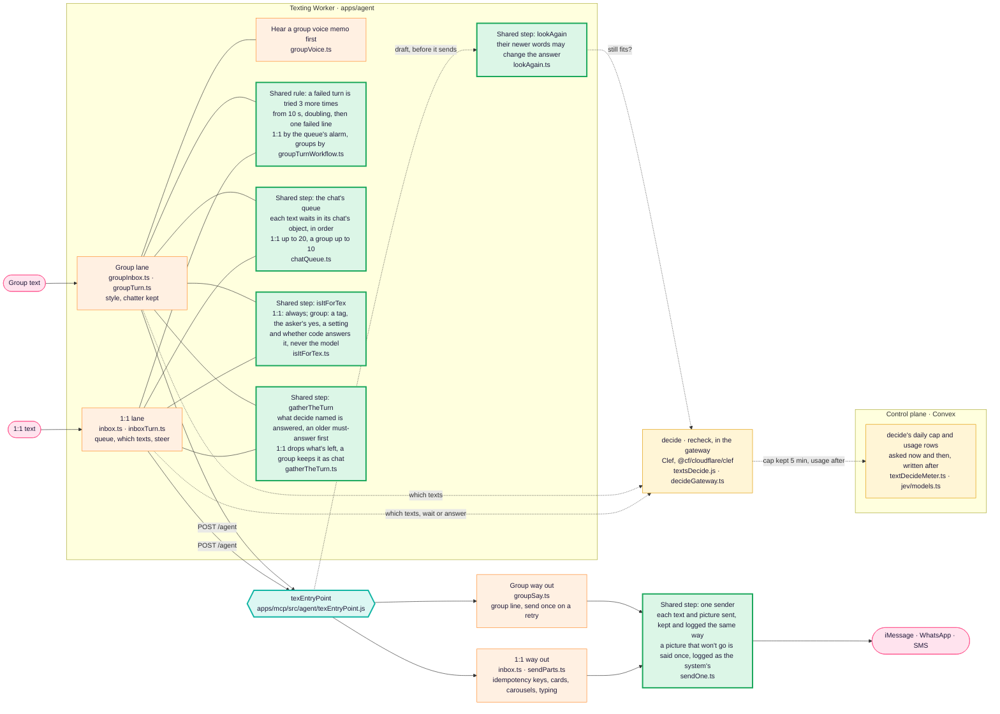
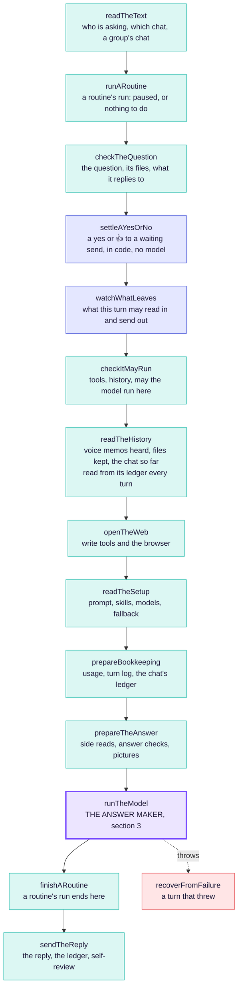
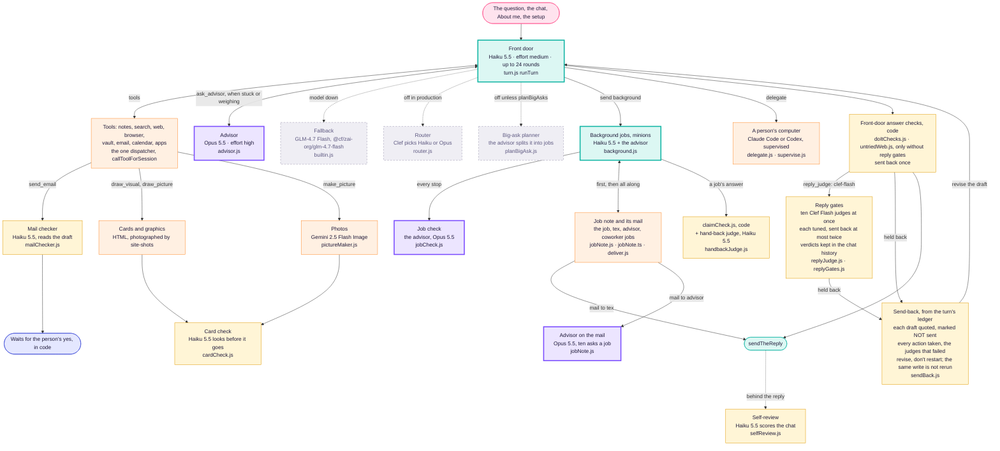

# How Tex works

The one architecture diagram of Tex: how a text reaches `texEntryPoint`, the
steps it runs, and the answer maker inside it with every model it calls.
**Any change to this architecture changes this file in the same pull request**
(Dev2, 2026-11-05: "have a standing rule that any change to the architecture
must change the diagram, that way I can always go to the diagram and see what
changed"). `scripts/tex-diagram-check.mjs` enforces it in CI; see
[the rule](#the-rule) at the bottom. What changed, and when, is the
[change log](#change-log) and this file's history.

Models named here are the production setup's
(`@context-lc ai/production/texting-assistant.md`, read on every turn by
`readTheSetup`) or the literal in the file named beside them.

## 1. A text on its way to the door

Every text, 1:1 or group, ends in the same `texEntryPoint`. What differs today
is the texting Worker in front of it (`apps/agent`), which has a lane for each.
The one-door plan folds the group lane into the door, step by step.

Green boxes are door steps both lanes already share. Each one-door pull
request moves another job out of the two lanes into one.

## 2. The door: texEntryPoint, top to bottom

One function (`apps/mcp/src/agent/texEntryPoint.js`), one file per step under
`apps/mcp/src/agent/texEntryPoint/`. A step either hands the turn on or answers
it; the first answer is the response. Every 1:1 text, group turn, background
job, job report and routine run takes this path.

<!-- tex-diagram: steps begin -->

<!-- tex-diagram: steps end -->

Blue steps are rails kept in code, never by a model: who may say yes, and what
may leave the turn (`privacy/egress.js`).

## 3. The answer maker: runTheModel and every model it calls

Grey dashed boxes are built but off in production today. Other models on the
way: voice memos are heard by Whisper in the transcribe Worker
(`ingestion/transcription.js`), and search by meaning uses BGE-M3 embeddings
(`search/meaning/embed.js`). Decide's Clef is in section 1, asked in the
gateway (`textsDecide.js`) through `decide.js`, the gateway's one call to it;
its cap and usage rows stay in the control plane.
What each model costs is `jev/meter.ts`.

## The rule

1. **A pull request that changes Tex's architecture changes this file.** That
   covers a step added, removed, renamed or reordered in `texEntryPoint`; a
   model, judge or check added, removed, switched on or off; a lane, queue or
   sender in the Worker; and anything this file names moving. Redraw the part
   that changed and add a line to the change log.
2. **CI checks it** (`scripts/tex-diagram-check.mjs`, in Fast repository
   guards):
   - every step `texEntryPoint.js` runs is drawn in section 2, in its order;
   - every file under `apps/mcp/src/agent/`, `apps/agent/src/` or
     `apps/convex/functions/lib/jev/` that names a model is named here;
   - a pull request that changes `texEntryPoint.js`, a file under
     `texEntryPoint/`, or any file this page names in backticks must change
     this page, or say why not in its description with a line
     `Tex diagram: unchanged because <reason>` (a fix inside a file that
     leaves the shape as drawn).

## Change log

Newest first. One line per pull request that changed the drawing.

- 2026-11-05: with the reply gates on, the older word checks they replace (`doItChecks.js`, `untriedWeb.js`) no longer run; tried_first and followed_them do their job. They stay for a setup without gates. Every gate reads each rewrite, a job's report no longer runs the gates, and a draft a late text holds is recorded as held.
- 2026-11-05: a send-back is written from the turn's ledger: the held draft is quoted as NOT sent (never put in as said), with every action the turn took and the judges that failed; the model revises it, and a write it already made (same tool, same arguments) is not run again.
- 2026-11-05: one sender: both lanes send and log each text and picture the same way (`sendOne.ts`); a 1:1 picture that won't go now shows in the history as the line the person was told. Cards and carousels stay 1:1 only until proven in groups.
- 2026-11-05: a 1:1 turn reads the chat so far from its ledger every turn, as a group's does; the warm copy no longer carries the chat (it never held Tex's own replies).
- 2026-11-05: decide and recheck move into the gateway; their daily cap and usage rows stay in Convex, off each text's path.
- 2026-11-05: the reply gates are on in production (setup `reply_judge: clef-flash`), and every judging of a draft (each gate's score, threshold, and whether
  the draft went or went back) is kept in the chat's history as a `judge` entry.
- 2026-11-05: every job gets a job note (its project's note, or Tex's own `tex/jobs/`); the job, Tex and the advisor join its mail; mail to tex reaches the chat's report turn, mail to advisor is answered on the note; computer jobs read and send it with their run grant.
- 2026-11-05: gatherTheTurn is shared: one rule for which waiting texts a turn answers (`gatherTheTurn.ts`).
- 2026-11-05: isItForTex is shared: one step says whether a text is for Tex and whether code answers it (`isItForTex.ts`).
- 2026-11-05: the queue is shared: both lanes put a text in line the same way (`chatQueue.ts`).
- 2026-11-05: retries are shared: a 1:1 turn that fails is tried 3 more times, as a group's.
- 2026-11-05: lookAgain is shared: 1:1 replies get the last look groups had (recheck takes `direct`).
- 2026-11-05: the reply judge becomes ten parallel Clef Flash gates, each
  tuned on its own set, sent back at most twice; still off in production.
- 2026-11-05: first drawing, from main at `d88e2bc` (Dev2's ask).
