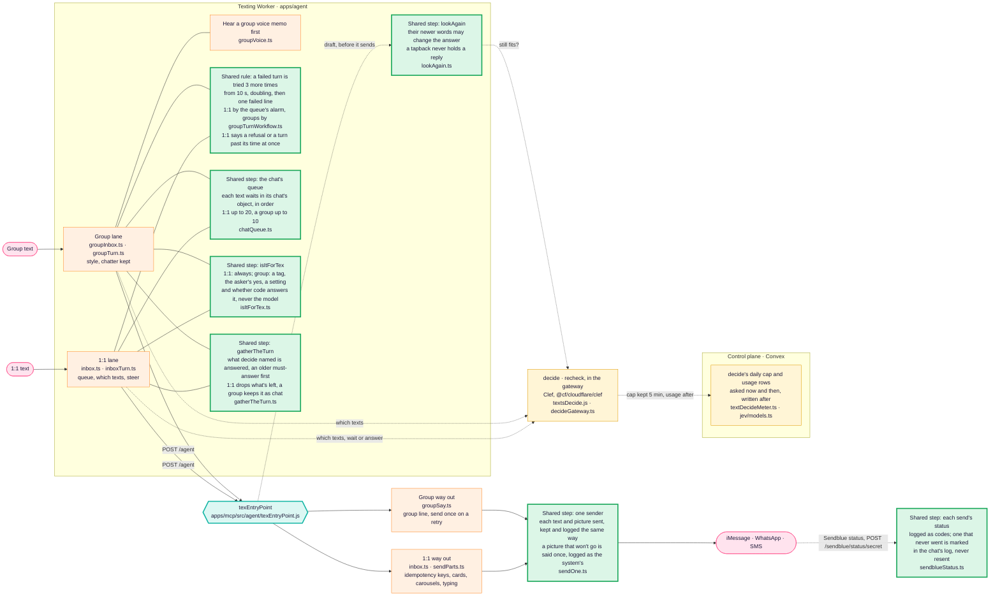
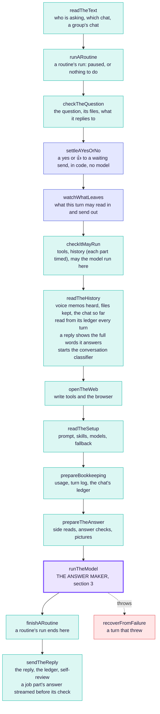
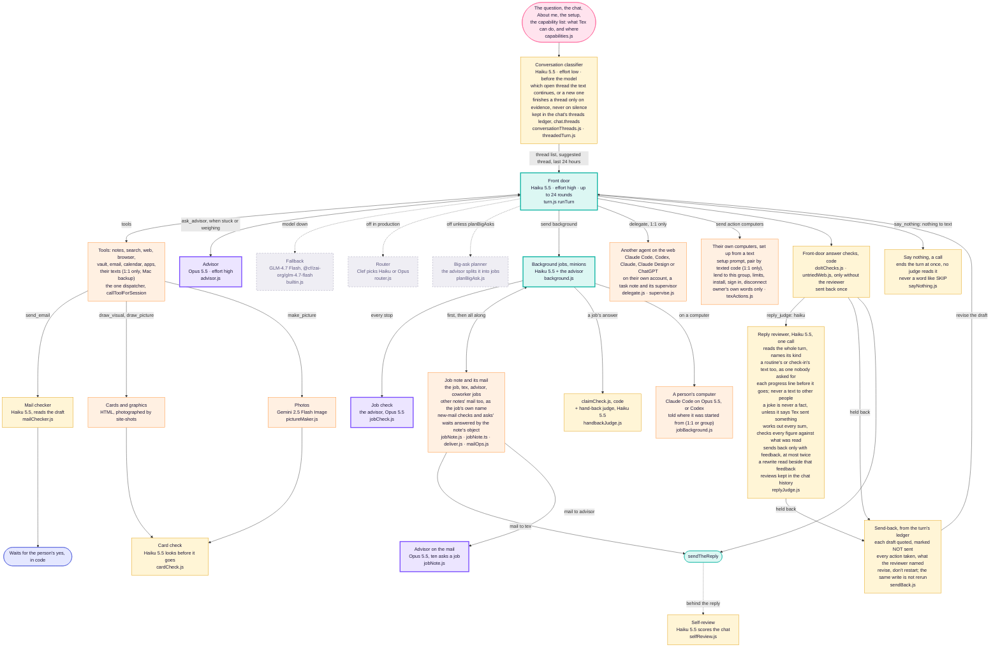

# How Tex works

The one architecture diagram of Tex: how a text reaches `texEntryPoint`, the
steps it runs, and the answer maker inside it with every model it calls.
**Any change to this architecture changes this file in the same pull request**
(Dev2, 2026-11-05: "have a standing rule that any change to the architecture
must change the diagram, that way I can always go to the diagram and see what
changed"). `scripts/tex-diagram-check.mjs` enforces it in CI; see
[the rule](#the-rule) at the bottom. What changed, and when, is the
[change log](#change-log) and this file's history.

Models named here are the production setup's
(`@context-lc ai/production/texting-assistant.md`, read on every turn by
`readTheSetup`) or the literal in the file named beside them.

## 1. A text on its way to the door

Every text, 1:1 or group, ends in the same `texEntryPoint`. What differs today
is the texting Worker in front of it (`apps/agent`), which has a lane for each.
The one-door plan folds the group lane into the door, step by step.

Green boxes are door steps both lanes already share. Each one-door pull
request moves another job out of the two lanes into one.

## 2. The door: texEntryPoint, top to bottom

One function (`apps/mcp/src/agent/texEntryPoint.js`), one file per step under
`apps/mcp/src/agent/texEntryPoint/`. A step either hands the turn on or answers
it; the first answer is the response. Every 1:1 text, group turn, background
job, job report and routine run takes this path.

<!-- tex-diagram: steps begin -->

<!-- tex-diagram: steps end -->

Blue steps are rails kept in code, never by a model: who may say yes, and what
may leave the turn (`privacy/egress.js`).

## 3. The answer maker: runTheModel and every model it calls

Grey dashed boxes are built but off in production today. Other models on the
way: voice memos are heard by Whisper in the transcribe Worker
(`ingestion/transcription.js`), and search by meaning uses BGE-M3 embeddings
(`search/meaning/embed.js`). Decide's Clef is in section 1, asked in the
gateway (`textsDecide.js`) through `decide.js`, the gateway's one call to it;
its cap and usage rows stay in the control plane.
What each model costs is `jev/meter.ts`.

## The rule

1. **A pull request that changes Tex's architecture changes this file.** That
   covers a step added, removed, renamed or reordered in `texEntryPoint`; a
   model, judge or check added, removed, switched on or off; a lane, queue or
   sender in the Worker; and anything this file names moving. Redraw the part
   that changed and add a line to the change log.
2. **CI checks it** (`scripts/tex-diagram-check.mjs`, in Fast repository
   guards):
   - every step `texEntryPoint.js` runs is drawn in section 2, in its order;
   - every file under `apps/mcp/src/agent/`, `apps/agent/src/` or
     `apps/convex/functions/lib/jev/` that names a model is named here;
   - a pull request that changes `texEntryPoint.js`, a file under
     `texEntryPoint/`, or any file this page names in backticks must change
     this page, or say why not in its description with a line
     `Tex diagram: unchanged because <reason>` (a fix inside a file that
     leaves the shape as drawn).

3. **Every Tex agent reads sections 1 to 3.** They are generated into
   `apps/mcp/src/agent/texArchitecture.generated.js` and put ahead of each
   agent's own prompt with one line naming its box (`texArchitecture.js`).
   After redrawing, run `node scripts/tex-architecture-module.mjs`; CI fails
   while the module is stale, and fails any file under `apps/mcp/src/agent/`
   that gives a model a system prompt without `withArchitecture`.

## Change log
Newest first. One line per pull request that changed the drawing.

- 2026-11-08: the housekeeping and overnight About me switches are also on the Tex page's Check-ins, for a person's own Tex (`switch.set`, `http/texPage/notes.js`); the capability list names them. No box changes.
- 2026-11-08: a job's part no longer runs again from nothing when the gateway fails after it answered (Dev2, "All three"): `sendTheReply` streams the part's answer as an `answered` line before the advisor's check (`answer_early`, `progress.js`), and the Worker keeps it if the stream then dies or ends failed (`clients.ts`); a part cut off before any answer hands its streamed steps to the next part, which reads them back first (`cutOff`, `jobRun.ts`, `background.js`); the Worker logs why each part carried on; the gateway's own log lines go to Workers Logs (`wrangler.toml` `[observability]`, invocation lines off).
- 2026-11-08: overlapping turns no longer cut each other off: a group chat's grant (and its home-only one) keeps a token a newer mint replaced until that token's own expiry, as a 1:1 texting grant already did (`earlierTokens.ts`, `liveGrants.ts`), so a person's job pass, its report and their next tag run at once; a job's report refused a model in a group is tried again on a fresh grant like any failed turn, and refused every time, or out of the day's background turns, the chat hears there is news, never silence (`groupModelTurn.ts`, `groupInbox.ts`). No box changes.
- 2026-11-08: Tex sets up a person's own computers itself instead of sending them to buttons (Dev2): `send` action `computers` hands the coding-agent setup prompt, approves a pairing code texted in their own 1:1, lends a computer to the group chat it's asked in (who, Ask me first), renames it, sets limits and more time, installs and signs in Claude Code or Codex, and disconnects it, each on the owner's own words (`texActions.js`, `setupPrompt.js`, `runTheModel.js`).
- 2026-11-08: one capability list (Dev2, "One capability list everywhere"): every line of what Tex can do, in a 1:1 text, a group chat and a guest chat, with who asks, drafts and approves, goes with the drawing to the front door (1:1, group, job), the advisor and the reviewer, the same bytes every turn; a test fails when an action, chat command or group command word is on no line (`capabilities.js`, `texArchitecture.js`, `test/capabilities.test.mjs`). A group with no mail shared is told how to share it, no longer to never offer it (`groupMail.js`).
- 2026-11-08: a feature audit filled the capability list: meetings, people and their messages, texts from their Mac, housekeeping, files and voice memos, tapbacks, texting while Tex works, group chats and their account each have a line, and every app-only setting found has a can't with the way around it; the list is about 6,500 tokens in the cached prefix (`capabilities.js`).
- 2026-11-08: the delegate box is drawn as what it is, another agent on the web (Claude Code, Codex, Claude, Claude Design or ChatGPT, 1:1 only), and a background job on a computer gets its own box (`jobBackground.js`). A check-in or a delivery of pings inside their quiet hours (`quiet-hours:` in `tex/heartbeat.md`) runs no model and tells the control plane when to come back (`quietHours.js`); emergencies still go. Housekeeping and the dream each have an off switch (`tex/housekeeping.md`, `tex/dreams.md`; `texSwitches.js`).
- 2026-11-07: the reply reviewer reads only texts to the person (Dev2): each progress line a long 1:1 turn texts is reviewed before it goes, as a line and not an answer, and one held back is not sent (`progress.js`, `runTheModel.js`); a routine that texts other people (`to:`) is no longer reviewed.
- 2026-11-07: a routine's run and a check-in may call `say_nothing` (neither was offered it, though both prompts named it: a routine texted its own note about the missing call), and the reply reviewer reads what each would text as a scheduled text nobody asked for, sending back one that talks about Tex's own run (`not_for_them`); a check-in follows the texting setup's `reply_judge`, and a routine that only writes a note is not reviewed (`runTheModel.js`, `heartbeat.js`, `replyJudge.js`).
- 2026-11-07: a conversation classifier sorts each chat text into a thread before the model (Haiku 5.5, effort low, 4 s cap), kept in the chat's threads ledger (`<chat>.threads`, an index rebuilt from the chat's ledger); the turn is shown up to 50 threads (open first), the suggested thread's older texts and the last 24 hours tagged by thread, and `read_thread` opens any thread (`conversationThreads.js`, `threadedTurn.js`, `readTheHistory.js`, `runTheModel.js`).
- 2026-11-07: the threads ledger is replayed once from each chat's whole history by the same classifier, off the turn's path (`threadsBackfill.js`, run through `POST /internal/threads/backfill` from the control plane); `readThreads` pages, since a replayed chat's threads can pass one read. No box changes: a turn reads the threads as before.
- 2026-11-06: every Tex agent reads this drawing: sections 1 to 3 go ahead of each one's own prompt (front door for 1:1, group and job turns, computer jobs, advisor, advisor on the mail, job check, reviewer, hand-back judge, mail checker, card check, self-review, day summaries, big-ask planner), with one line naming the box it is (`texArchitecture.js`, generated into `texArchitecture.generated.js` by `scripts/tex-architecture-module.mjs`).
- 2026-11-06: the reviewer's rubric is tuned on the bench to 98-99% of faults caught with 2-4% false alarms: a joke that says Tex sent something is a claim, every sum is worked out, a figure must come from what was read, and a page or card is told in a line (`replyJudge.js`).
- 2026-11-06: day summaries reach back through the whole chat, newest first, twenty a night, quiet nights included (`daySummaries.js`, `dream.js`).
- 2026-11-06: after the dream, each finished day of the last week with no summary is summed up by Haiku into a `day` ledger entry; a turn whose chat runs past what it reads opens its history with the summaries of the days before every text it shows (`daySummaries.js`, `dream.js`, `ledgerHistory.js`, `loggedTurn.js`).
- 2026-11-06: a turn's chat history fades by age from the text it answers: that day and the day before whole, older texts clipped (Tex's answers most, links kept), the oldest day whole or not at all (`ledgerHistory.js`, `loggedTurn.js`).
- 2026-11-06: the setup may name the module notes (`ai/production/prompt/<name>.md`) each kind of turn (1:1 text, group, job) is built from, read with it into the warm copy; without `modules` the body is the prompt as before (`promptModules.js`, `production.js`, `runTheModel.js`).
- 2026-11-06: a 1:1 turn reads `tex/calendar.md`, a copy of their next seven days (times, titles, places), with About me in the desk call and shows it in `system.context` as a copy; behind the reply a copy over ten minutes old, or one the turn changed, is read again live (`calendarCache.js`, `texDesk.js`, `sendTheReply.js`).
- 2026-11-06: the advisor's brief carries the person block (`<about_them>`: about, jobs, voice, workspaces) and the turn's time line (`<this_moment>`) whole, beside a short hard-rules paragraph, instead of the front door's 45,000-character rules cut at 40,000 (which dropped the person); the job check no longer gets Tex's instructions at all, only the job, its messages and its answer (`advisor.js`, `jobCheck.js`, `builtin.js`).
- 2026-11-06: a turn's history is timed part by part (`history_memory`, `history_ledger`, `history_log`) and, in a group, each of its five memory notes apart (`history_group_record`, `_playbook`, `_voice`, `_about`, `_jobs`), read with the `tex-text-timings` workflow; nothing read changed.
- 2026-11-06: a group's job with no project note gets one in its workspace's `projects/tex-jobs/` (it had none: no mail, no advisor, no Tex); a computer part's brief always names its advisor; a cloud job's turn thinks at `models.job_effort` (`jobNote.js`, `jobBackground.js`, `production.js`).
- 2026-11-06: a note's new-mail line and an ask's wait are answered by the note's workspace object (`mailOps.js`): one call each, no whole-note reads or 1.5-second polling (`mail.js`, `footer.js`).
- 2026-11-06: a computer job may join any other note's mail it reaches, always as its job's own name and bound to its job (never tex, advisor, another job or a machine); a refused join says permission denied instead of "try again" (`noteMail.ts`, `mail.js`, roster in `jobNote.js`).
- 2026-11-06: one Haiku reviewer replaces the ten Clef Flash reply gates: one call reads the whole turn, names its kind (task, question, chat, correction, report), and sends a draft back only with feedback quoting the words to change, at most twice; a rewrite is read beside that feedback. `reply_judge: clef-flash` now means the reviewer (`replyJudge.js`; `replyGates.js` removed; bench `pnpm ai review`).
- 2026-11-05: Tex chooses silence by calling `say_nothing` (front door, routines, check-ins, reports, job supervision), which ends the turn before any judge reads it; no prompt asks for SKIP any more, and a stray SKIP is never judged or texted. A group's last look ignores tapbacks, as a 1:1 chat's did. `job_status` shows up to 8,000 characters of a report.
- 2026-11-05: what Tex texts about a job's report is judged by a report set of its own (reached_them: the result itself reaches them, links kept; on_a_page: a long result on a page or card with its link), never the text set; short_and_clean reads only a draft over 60 words (30 beside a page, card or picture it made) or one in a script they never write in, which code fails as a fact; on_a_page reads a report's text over 30 words. Fixes the wiring that sent report turns through every text gate.
- 2026-11-05: with the reply gates on, the older word checks they replace (`doItChecks.js`, `untriedWeb.js`) no longer run; tried_first and followed_them do their job. They stay for a setup without gates. Every gate reads each rewrite, a job's report no longer runs the gates, and a draft a late text holds is recorded as held.
- 2026-11-05: a 1:1 turn holds the person's own texts from their Mac's Messages backup (`search` with `{ texts: true, with, since }`, `fetch texts:<id>`; `sixTools.js`), so "what did Ada send me" is found; bare `texts:` stays this chat's history, and group chats never get them.
- 2026-11-05: a reply (inline, or a text in a thread; 1:1 or group) is logged with the id and full words of the message it answers (`replyQuote.ts`); the turn shows it on that line as "replying to …", and the vague thread note is gone when the ledger is read.
- 2026-11-05: a text that comes in while Tex writes is handled like a send-back (the draft quoted as NOT sent, writes not repeated), and a reworded email to the same people counts as the same write.
- 2026-11-05: review fixes: a 1:1 turn the gateway refused, or that ran past its time, is no longer retried; the last look keeps the draft in view on a long chat (the transcript gives way from its oldest end).
- 2026-11-05: a send-back is written from the turn's ledger: the held draft is quoted as NOT sent (never put in as said), with every action the turn took and the judges that failed; the model revises it, and a write it already made (same tool, same arguments) is not run again.
- 2026-11-05: one sender: both lanes send and log each text and picture the same way (`sendOne.ts`); a 1:1 picture that won't go now shows in the history as the line the person was told. Cards and carousels stay 1:1 only until proven in groups.
- 2026-11-05: a 1:1 turn reads the chat so far from its ledger every turn, as a group's does; the warm copy no longer carries the chat (it never held Tex's own replies).
- 2026-11-05: decide and recheck move into the gateway; their daily cap and usage rows stay in Convex, off each text's path.
- 2026-11-05: the reply gates are on in production (setup `reply_judge: clef-flash`), and every judging of a draft (each gate's score, threshold, and whether
  the draft went or went back) is kept in the chat's history as a `judge` entry.
- 2026-11-05: a computer job's model, wait after its answer and runner prompt are read from `ai/production/computer-jobs.md` on every part and sent with it (runner 0.2.9), so they change without a release.
- 2026-11-05: a computer job's brief opens with its background (`jobBackground.js`): started 1:1 (acts as the person) or from a group (the group's reach only), Context and `orient` first, keyed API calls through Context, only Tex reaches the person, a part ends at its answer. Claude Code is pinned to Opus 5.5, the runner ends a part ten seconds after its answer, and a run may make keyed API calls (`send` action `api`), a group's run with the group's keys only.
- 2026-11-05: every job gets a job note (its project's note, or Tex's own `tex/jobs/`); the job, Tex and the advisor join its mail; mail to tex reaches the chat's report turn, mail to advisor is answered on the note; computer jobs read and send it with their run grant.
- 2026-11-05: gatherTheTurn is shared: one rule for which waiting texts a turn answers (`gatherTheTurn.ts`).
- 2026-11-05: isItForTex is shared: one step says whether a text is for Tex and whether code answers it (`isItForTex.ts`).
- 2026-11-05: the queue is shared: both lanes put a text in line the same way (`chatQueue.ts`).
- 2026-11-05: retries are shared: a 1:1 turn that fails is tried 3 more times, as a group's.
- 2026-11-05: lookAgain is shared: 1:1 replies get the last look groups had (recheck takes `direct`).
- 2026-11-05: the reply judge becomes ten parallel Clef Flash gates, each
  tuned on its own set, sent back at most twice; still off in production.
- 2026-11-05: first drawing, from main at `d88e2bc` (Dev2's ask).
