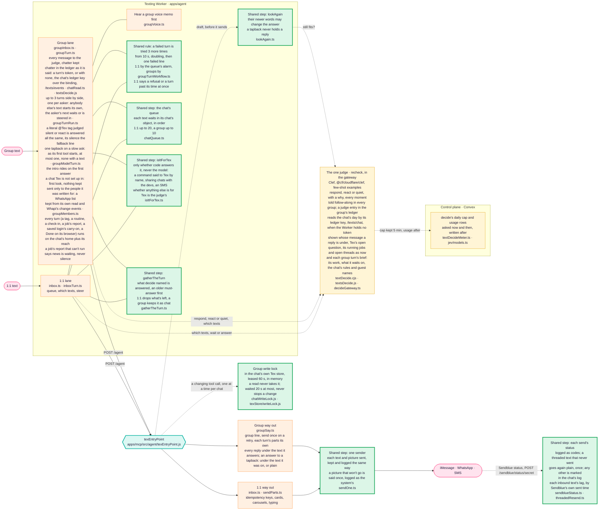
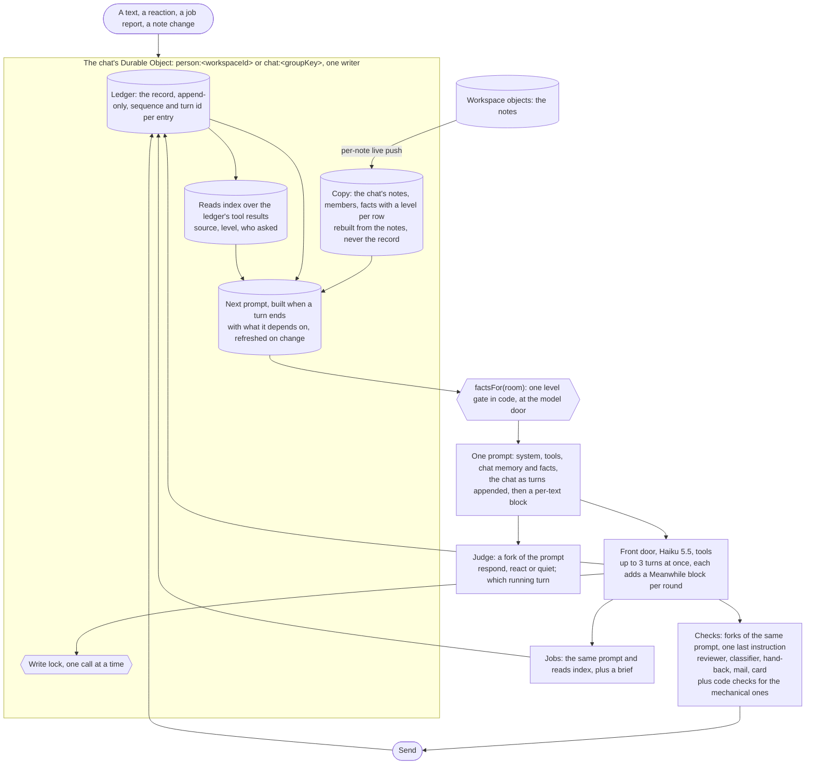

# How Tex works

The one architecture diagram of Tex: how a text reaches `texEntryPoint`, the
steps it runs, and the answer maker inside it with every model it calls.
**Any change to this architecture changes this file in the same pull request**
(Dev2, 2026-11-05: "have a standing rule that any change to the architecture
must change the diagram, that way I can always go to the diagram and see what
changed"). `scripts/tex-diagram-check.mjs` enforces it in CI; see
[the rule](#the-rule) at the bottom. What changed, and when, is the
[change log](#change-log) and this file's history.

Models named here are the production setup's
(`@context-lc ai/production/texting-assistant.md`, read on every turn by
`readTheSetup`) or the literal in the file named beside them.

## 1. A text on its way to the door

Every text, 1:1 or group, ends in the same `texEntryPoint`. What differs today
is the texting Worker in front of it (`apps/agent`), which has a lane for each.
The one-door plan folds the group lane into the door, step by step.



Green boxes are door steps both lanes already share. Each one-door pull
request moves another job out of the two lanes into one.

## 2. The door: texEntryPoint, top to bottom

One function (`apps/mcp/src/agent/texEntryPoint.js`), one file per step under
`apps/mcp/src/agent/texEntryPoint/`. A step either hands the turn on or answers
it; the first answer is the response. Every 1:1 text, group turn, background
job, job report and routine run takes this path.

```mermaid
flowchart TB
  readTheText["readTheText<br/>who is asking, which chat, a group's chat<br/>and the apex its own email address is on"]:::step
  runARoutine["runARoutine<br/>a routine's run: paused, or nothing to do"]:::step
  checkTheQuestion["checkTheQuestion<br/>the question, its files, what it replies to"]:::step
  settleAYesOrNo["settleAYesOrNo<br/>a yes or 👍 to a waiting send, in code, no model"]:::rail
  watchWhatLeaves["watchWhatLeaves<br/>what this turn may read in and send out"]:::rail
  checkItMayRun["checkItMayRun<br/>tools, history (each part timed), may the model run here"]:::step
  readTheHistory["readTheHistory<br/>voice memos heard, files kept, the chat so far<br/>read from its ledger every turn, a routine, check-in, job report or job's part too<br/>a reply shows the full words it answers<br/>under each earlier text, what it read for it, quoted<br/>starts the conversation classifier"]:::step
  openTheWeb["openTheWeb<br/>write tools and the browser"]:::step
  readTheSetup["readTheSetup<br/>prompt, skills, models, fallback"]:::step
  prepareBookkeeping["prepareBookkeeping<br/>usage, turn log, failed tool calls, the chat's ledger"]:::step
  prepareTheAnswer["prepareTheAnswer<br/>side reads, answer checks, pictures"]:::step
  runTheModel["runTheModel<br/>THE ANSWER MAKER, section 3"]:::model
  finishARoutine["finishARoutine<br/>a routine's run ends here"]:::step
  sendTheReply["sendTheReply<br/>the reply, the ledger, self-review<br/>the reply keeps its facts: each claim, its source, a quote<br/>a job part's answer streamed before its check"]:::step
  recoverFromFailure["recoverFromFailure<br/>a turn that threw"]:::fail
  readTheText --> runARoutine --> checkTheQuestion --> settleAYesOrNo --> watchWhatLeaves --> checkItMayRun --> readTheHistory --> openTheWeb --> readTheSetup --> prepareBookkeeping --> prepareTheAnswer --> runTheModel --> finishARoutine --> sendTheReply
  runTheModel -. throws .-> recoverFromFailure
  classDef step fill:#dcf7f3,stroke:#11b5a4,color:#1d1838
  classDef rail fill:#e4e7ff,stroke:#3c4bd6,color:#1d1838
  classDef model fill:#ece5ff,stroke:#7b4dff,stroke-width:3px,color:#1d1838
  classDef fail fill:#ffe5e6,stroke:#e5484d,color:#1d1838
```

<!-- tex-diagram: steps begin -->

<!-- tex-diagram: steps end -->

Blue steps are rails kept in code, never by a model: who may say yes, and what
may leave the turn (`privacy/egress.js`).

## 3. The answer maker: runTheModel and every model it calls

```mermaid
flowchart TB
  Q([The question, the chat, About me, the setup,<br/>the capability list: what Tex can do, and where<br/>capabilities.js<br/>today's date for every model below, at its door,<br/>and every earlier text with its day and time<br/>localNow.js withToday · stamped]):::you -->|thread list as it stood after the text before,<br/>old moments that fit, with age and reactions,<br/>last 24 to 30 hours, its start on a 6-hour step so it reads from cache,<br/>with day ages and quiet stretches<br/>threadedTurn.js · callbacks.js · chatTime.js| FD
  CL["Conversation classifier<br/>Haiku 5.5 · thinking off · after the reply, never waited for<br/>which open thread the text continues, or a new one<br/>finishes a thread only on evidence, never on silence<br/>whether to answer at all is the Worker's one judge's<br/>kept in the chat's threads ledger, chat.threads, for the next text<br/>conversationThreads.js · threadedTurn.js"]:::judge
  SEND -. behind the reply .-> CL
  FD["Front door<br/>Haiku 5.5 · effort medium · up to 24 rounds<br/>turn.js runTurn"]:::haiku
  FD <-->|tools| T["Tools: notes, search, web, browser,<br/>vault, email, calendar, apps,<br/>their texts (1:1 only, Mac backup)<br/>the one dispatcher, callToolForSession"]:::tool
  T -. a call fails .-> TF["Failed tool calls kept, every model with tools<br/>tool, cause code, reason with its values taken out<br/>logged at once, then rows naming nobody<br/>tex.lc/admin: Why tools fail<br/>toolFailures.js · texToolFailures.ts"]:::tool
  FD <-->|ask_advisor, when stuck or weighing| ADV["Advisor<br/>Opus 5.5 · effort high<br/>up to 40 s for a text, 90 s in a job<br/>advisor.js · its words advisorRoles/chat.js<br/>replayed alone: advisor-chat"]:::opus
  FD -. model down .-> FB["Fallback<br/>GLM-4.7 Flash, @cf/zai-org/glm-4.7-flash<br/>builtin.js"]:::off
  FD -. off in production .-> RT["Router<br/>Clef picks Haiku or Opus<br/>router.js"]:::off
  FD -. off unless planBigAsks .-> PL["Big-ask planner<br/>the advisor splits it into jobs<br/>planBigAsk.js · its words advisorRoles/planner.js<br/>replayed alone: advisor-planner"]:::off

  FD -->|"send background, ending the turn<br/>with its say line, or a tapback without one<br/>judged from job-start examples, jobStart.js"| JOB["Background jobs, minions<br/>Haiku 5.5 + the advisor<br/>handed their open ask word for word beside the brief<br/>starts with the pages the chat opened<br/>background.js · openAsk.js · jobPages.js"]:::haiku
  JOB -->|every stop| JC["Job check<br/>the advisor, Opus 5.5<br/>against the finish line and every part of their own words<br/>jobCheck.js · its words advisorRoles/jobCheck.js<br/>replayed alone: advisor-job-check"]:::opus
  JOB <-->|first, then all along| JN["Job note and its mail<br/>the job, tex, advisor, coworker jobs<br/>other notes' mail too, as the job's own name<br/>new-mail checks and asks' waits answered by the note's object<br/>jobNote.js · jobNote.ts · deliver.js · mailOps.js"]:::tool
  JN -->|mail to tex| SEND
  JN -->|mail to advisor| JNA["Advisor on the mail<br/>Opus 5.5, ten asks a job<br/>jobNote.js · its words advisorRoles/jobMail.js<br/>replayed alone: advisor-job-mail"]:::opus
  ADVC["The advisor's shared core: one model, four roles<br/>each asked one way, the drawing ahead of its own words<br/>a change here replays all four roles<br/>advisorRoles/core.js adviseOnce"]:::opus
  ADVC -.- ADV
  ADVC -.- PL
  ADVC -.- JC
  ADVC -.- JNA
  JOB -->|a job's answer| JCK["claimCheck.js, code<br/>+ hand-back judge, Haiku 5.5<br/>handbackJudge.js"]:::judge
  JOB -->|on a computer| PC["A person's computer<br/>Claude Code on Opus 5.5, or Codex<br/>told where it was started from (1:1 or group)<br/>jobBackground.js"]:::tool
  FD -->|delegate, 1:1 only| DL["Another agent on the web<br/>Claude Code, Codex, Claude, Claude Design or ChatGPT<br/>on their own account, a task note and its supervisor<br/>delegate.js · supervise.js"]:::tool
  FD -->|send action computers| CS["Their own computers, set up from a text<br/>setup prompt, pair by texted code (1:1 only),<br/>lend to this group, limits, install, sign in, disconnect<br/>owner's own words only · texActions.js"]:::tool
  FD -->|send tex_settings, setting, vault_access| ST["Every setting, from a text<br/>one list: texSettings.cjs, also the app's rows<br/>check-ins, quiet hours, pings, overnight, tidy (1:1)<br/>who can use each saved login: chat, workspace, @person<br/>invite everyone here to a workspace, sent by the Worker after the answer<br/>saver's own words, widening judged · settingsTools.js · vaultByText.ts"]:::tool
  FD -->|"send ask_personal_tex, groups only"| PT["The tagger's personal Tex, asked for who they are<br/>name, phone, emails from their account, for a form or sign-in<br/>their own tag: says it is asking, then asks<br/>anyone else here: offered, runs on their own 👍 or yes<br/>askPersonalTex.js · texIdentity/identity.ts"]:::tool

  T -->|send_email| MC["Mail checker<br/>Haiku 5.5, reads the draft<br/>mailChecker.js"]:::judge
  MC --> YES([Waits for the person's yes, in code]):::rail
  T -->|write_note of a page| PW["Page pictures, code, before the save<br/>fills each option with no photo, or one it names but never attached<br/>a photo address the turn read goes in as bytes, no judge<br/>pagePhotos.js · pageReadImages.js"]:::tool
  PW -->|an address the turn never read| SJ["Sharing judge<br/>the person's own words must ask for it<br/>widening.js · judge.js"]:::judge
  T -->|draw_visual, draw_picture| PIC["Cards and graphics<br/>HTML, photographed by site-shots<br/>an item with no photo is a No photo found tile, never a blank slot"]:::tool
  T -->|make_picture| IMG["Photos<br/>Gemini 2.5 Flash Image<br/>pictureMaker.js"]:::tool
  PIC --> CC["Card check<br/>Haiku 5.5 looks before it goes<br/>told which places have no pin<br/>cardCheck.js"]:::judge
  IMG --> CC

  FD --> CHK["Front-door answer checks, code<br/>doItChecks.js · untriedWeb.js, without the reviewer or on a draft it skips<br/>web findings texted as a wall go back to be a page, workPage.js<br/>a page saved with no picture and no cover call goes back to draw it, pageCoverFloor.js<br/>sent back once"]:::judge
  FD -->|say_nothing: nothing to text| QT["Say nothing, a call<br/>ends the turn at once, no judge reads it<br/>never a word like SKIP<br/>sayNothing.js"]:::judge
  CHK -->|reply_judge: haiku,<br/>a draft after an action| RJ["Reply reviewer, Haiku 5.5, one call<br/>a draft written with no action is not read<br/>reads the whole turn, names its kind<br/>checks the whole open ask, not only the newest text<br/>a changed pick or figure must say why<br/>a routine's or check-in's text too, as one nobody asked for,<br/>on its last step too: sent back there, nothing is texted<br/>never a progress line, never a text to other people<br/>a joke is never a fact, unless it says Tex sent something<br/>works out every sum, checks every figure against what was read<br/>a take-back nothing read this turn backs goes back, read with no action too<br/>sends back only with feedback, at most once,<br/>a task or a job's report up to five times, asking the advisor from the third, while the turn has time<br/>reviews kept in the chat history<br/>replyJudge.js"]:::judge
  CHK -->|held back| SB["Send-back, from the turn's ledger<br/>each draft quoted, marked NOT sent<br/>every action taken, what the reviewer named<br/>revise, don't restart; the same write is not rerun<br/>sendBack.js"]:::judge
  RJ -->|held back| SB
  SB -->|revise the draft| FD
  CHK --> SEND([sendTheReply]):::door
  SEND -. behind the reply .-> SR["Self-review<br/>Haiku 5.5 scores the chat<br/>selfReview.js"]:::judge

  classDef you fill:#ffe3ee,stroke:#ff4f8b,color:#1d1838
  classDef haiku fill:#dcf7f3,stroke:#11b5a4,stroke-width:3px,color:#1d1838
  classDef opus fill:#ece5ff,stroke:#7b4dff,stroke-width:3px,color:#1d1838
  classDef judge fill:#fff5d6,stroke:#e09a00,color:#1d1838
  classDef tool fill:#fff0e2,stroke:#ff8a2a,color:#1d1838
  classDef rail fill:#e4e7ff,stroke:#3c4bd6,color:#1d1838
  classDef door fill:#dcf7f3,stroke:#11b5a4,color:#1d1838
  classDef off fill:#efeef4,stroke:#9a97b0,stroke-dasharray:5 4,color:#5d5880
```



Grey dashed boxes are built but off in production today. Other models on the
way: voice memos are heard by Whisper in the transcribe Worker
(`ingestion/transcription.js`), and search by meaning uses BGE-M3 embeddings
(`search/meaning/embed.js`). Decide's Clef is in section 1, asked in the
gateway (`textsDecide.js`) through `decide.js`, the gateway's one call to it;
its cap and usage rows stay in the control plane.
What each model costs is `jev/meter.ts`.

## The rule

1. **A pull request that changes Tex's architecture changes this file.** That
   covers a step added, removed, renamed or reordered in `texEntryPoint`; a
   model, judge or check added, removed, switched on or off; a lane, queue or
   sender in the Worker; and anything this file names moving. Redraw the part
   that changed and add a line to the change log.
2. **CI checks it** (`scripts/tex-diagram-check.mjs`, in Fast repository
   guards):
   - every step `texEntryPoint.js` runs is drawn in section 2, in its order;
   - every file under `apps/mcp/src/agent/`, `apps/agent/src/` or
     `apps/convex/functions/lib/jev/` that names a model is named here;
   - a pull request that changes `texEntryPoint.js`, a file under
     `texEntryPoint/`, or any file this page names in backticks must change
     this page, or say why not in its description with a line
     `Tex diagram: unchanged because <reason>` (a fix inside a file that
     leaves the shape as drawn).

3. **Every Tex agent reads sections 1 to 3.** They are generated into
   `apps/mcp/src/agent/texArchitecture.generated.js` and put ahead of each
   agent's own prompt with one line naming its box (`texArchitecture.js`).
   After redrawing, run `node scripts/tex-architecture-module.mjs`; CI fails
   while the module is stale, and fails any file under `apps/mcp/src/agent/`
   that gives a model a system prompt without `withArchitecture`.

## Every step, from Tex's config

<!-- tex-config: steps begin -->
Generated from `packages/shared/src/texConfig.json` by `scripts/tex-config-table.mjs`. Do not edit: change the config (the Lab's Promote) and run the script.

| Step | | Model | Effort | Time limit | Reads, in order | Where |
| --- | --- | --- | --- | --- | --- | --- |
| Check-in | on | code |  |  |  | heartbeat.js |
| Routine runs | on | code |  |  |  | routine.js · runARoutine.js |
| Send through Tex | on | code |  |  |  | tools/attention.js · attention.js |
| A text arrives | on | code |  |  |  | apps/agent |
| Decide | on | Clef |  |  | examples, recent, groupBrief, date | textsDecide.js · textDecide.cjs |
| Queue | on | code |  |  |  | apps/agent inbox.ts · groupTurn.ts |
| Door steps | on | code |  |  |  | texEntryPoint/* |
| Router | off | Clef |  |  | recent | router.js |
| Front door | on | Haiku 5.5 | medium |  | tools, skills, map, p-about-tex, p-rules, p-tools, p-working, p-sound-like-a-person, p-pictures, p-how-you-talk, caps, hist, threads, about, date, ask | turn.js runTurn |
| Fallback | on | GLM-4.7 Flash |  |  |  | builtin.js |
| Big-ask planner | off | Opus 5.5 | high |  | own, ask, caps | planBigAsk.js |
| Tools | on | code |  |  |  | callToolForSession |
| Advisor | on | Opus 5.5 | high | 40 s | own, caps, about, ask, ledger, hist, date | advisor.js · advisorRoles/chat.js |
| Answer checks | on | code |  |  |  | doItChecks.js |
| Mail checker | on | Haiku 5.5 | low |  | own, draft, ask | mailChecker.js |
| Card check | on | Haiku 5.5 | medium |  | own, draft | cardCheck.js |
| Reply reviewer | on | Haiku 5.5 | low | 8 s | own, ledger, ask, draft, hist, date | replyJudge.js · sendBack.js |
| Text them | on | code |  |  |  | sendTheReply · sendOne.ts |
| React | on | code |  |  |  | decide.ts reactionFor · reactions.ts |
| Classifier | on | Haiku 5.5 | off | 4 s | own, threads, recent | conversationThreads.js |
| Self-review | on | Haiku 5.5 | low |  | own, hist | selfReview.js |
| Background job | on | Haiku 5.5 | medium |  | tools, map, p-about-tex, p-rules, p-tools, p-working, brief, ask, date | background.js |
| Job check | on | Opus 5.5 | high |  | own, brief, ask, ledger, out:job | jobCheck.js |
| Advisor on job mail | on | Opus 5.5 | high |  | own, brief, ask | jobNote.js · advisorRoles/jobMail.js |
| Hand-back judge | on | Haiku 5.5 | low |  | own, brief, draft | handbackJudge.js · claimCheck.js |

Wires: checkin → fd (wait) · routine → door (wait) · notify → send (wait) · text → decide (wait) · decide → react (wait) · decide → lanes (wait) · lanes → door (wait) · door → fd (wait) · door → router (wait) · router → fd (wait) · fd → tools (uses, action) · fd → advisor (uses, stuck) · fd → fallback (uses, down) · fd → planner (uses, big) · tools → mail (uses, email) · tools → card (uses, card) · fd → checks (wait) · checks → reviewer (wait, action) · checks → send (wait) · reviewer → send (wait, action) · reviewer → fd (loop, action) · checks → fd (loop) · send → classifier (behind) · send → selfreview (behind) · fd → job (job, job) · job → tools (uses, job) · job → jobcheck (uses, job) · job → handback (job, job) · job → mailadv (uses, job)
<!-- tex-config: steps end -->

## Change log
Newest first. One line per pull request that changed the drawing.

- 2026-11-14: every model round keeps the prompt it was sent as its modules' ids, lengths and fingerprints plus the builder inputs a rebuild cannot read from notes (when, the time zone, the model, how much history), never the words (Dev2: "keep the ids of the prompt modules loaded in, so they can be reconstructed along with the date and version control"; `promptManifest.js`, `turnPrompt.js`, `turnTiming.js` v2); with the reply's `version.code`, a rebuild runs the builders of the commit that ran ("run the exact version from the day it ran"). A check-in's steps (thinking, tools, judging) now reach the person's chat ledger under a turn of their own (`ck…`), and a texted check-in's and a routine's note keep the run's milliseconds, code version and timing, so Replay shows them like a text's turn (`heartbeat.js`, `conversation.js`, `finishARoutine.js`). The prompt's bytes are unchanged, so no box changes. Tests: `apps/mcp/test/promptManifest.test.mjs`, `turnTiming.test.mjs`, `agentHeartbeat.test.mjs`, `agentRoutineTex.test.mjs`.
- 2026-11-14: Door steps writes a `door` step to the chat's ledger every turn: the kind of turn, the chat and the text ids it covers, and every setting the turn runs with (model, effort, reviewer, advisor, planner, fallback, router, computers, skills), never the chat's words (`runTheModel.js`); a group's judging keeps what it was asked as references, the ids of the texts it weighed, whether a turn was running, its style and how much it read (`textsDecide.js`). Dev2: "Every single block should have proper logging of what's going in and out and what parameters were set". Ledger writes only, so no box changes. Tests: `apps/mcp/test/chatLedgerWrites.test.mjs`, `textsDecide.test.mjs`, replay case `door-settings-logged`.
- 2026-11-14: Tex's prompt words are the repository's, `packages/shared/src/texPrompt/<name>.md`, and which modules each kind of turn reads, in order, is the config's (the `p-` entries of the front door's and the background job's context; `texConfig.js` `texModules`), so the texting setup note names no modules (Dev2 chose "In the repo, beside the config"). The Lab's Promote writes a version's new words into those files in the same pull request as the config. The words and their order are unchanged, so no box changes. Tests: `apps/mcp/test/texConfig.test.mjs`.

- 2026-11-13: "Every step, from Tex's config" is generated from `packages/shared/src/texConfig.json` (`scripts/tex-config-table.mjs`), and `tex-diagram-check.mjs` fails when it is stale or when a box in sections 1 to 3 names another model or effort than the config's step for that file (Dev2: the Lab's config is "the only source of truth"). It sits after "The rule", so it is not in any prompt.
- 2026-11-13: every model, effort, on or off and time limit in sections 1 to 3 is Tex's one config's, `packages/shared/src/texConfig.json`, the Lab's graph of main (Dev2: "I want the config generated by the lab to become the production code, and to be the only source of truth"). The judges ask `texConfig.js` for their step's model, effort and time limit, and the texting setup's models come from it, not from the setup note. The boxes are unchanged: the values are the same.
- 2026-11-13: the texting Worker's own steps reach the chat's ledger too, closing what the line below left out (Dev2: "every step should log its input output time and stuff, we need to be able to replay everything and track bugs and regressions"). A person's own chat's judging (`inboxTurn.ts` `ask`: the ids it was asked about, never the transcript's words, and the verdict or why it failed) and every tapback Tex sends, in a 1:1 chat or a group (who chose it, the emoji asked for and sent, the text it was on, how long the line took, whether it went), are `step` events in the Worker's outbox (`stepEvents.ts`), posted with the chat's other events to `/agent/events` or the group's ledger route, checked there (`log.js` `checkStep`: from the system, `decide` or `react`, no words, bounded input and output) and kept as `step` entries by their event id (`ledger.js` `eventEntry`). No reader of the chat shows one: the outbox's readers (`events.ts` `keptEvents`, `recentEvents`) leave them out, `checkEvent` refuses the kind, and the bucket's old log never keeps one. No box changes. Replay case: `worker-steps-logged`. Tests: `apps/agent/src/stepEvents.test.ts`, `apps/mcp/test/workerSteps.test.mjs`.
- 2026-11-13: every step of a turn leaves its input, output, time and outcome in the chat's ledger (Dev2: "every step should log its input output time and stuff, we need to be able to replay everything and track bugs and regressions"). A new `step` entry (`ledger.js` `stepEntry`, `stepLog`; `texStore/ledger.js` takes the kind) is written for each named step the door and the answer maker time (`timing`, from `texTiming.js` `logTo`: every step so far in one append before the reply, each one after the response as it ends, a failed turn's too in `recoverFromFailure.js`), the router's pick with the question and tier, the fallback with the model that failed and its status, a model switch, a steer (`turn.js` tells, `ledgerObserver`), the answer check with no reviewer (`checks`, or `handback` for `claimCheck.js` with the hand-back judge: the draft in, the notice out), the card check (`card`: tool and template, never the picture, and its verdict; `pictureMaker.js`), the chat's write lock (`lane`: which call waited and how long; `chatWriteLock.js`), the conversation classifier (`classifier`: the threads it filed), the self-review (`selfreview`), the job mail advisor (`mailadv`, tagged with its job; `jobNote.js`) and a group's look-again or failed judging (`decide`; `textsDecide.js`). Inputs and outputs are kept like a tool's arguments and result: secrets hidden, long ones cut. Each tool call's trace also names the six it was made as and its action (`turnLog.js` `traceNames`), for the Lab's Tools page. Still unlogged: a 1:1 judging and its tapback, which happen in the texting Worker. No box changes: no step, model or wire is added, moved or removed, only what each one leaves in the ledger (and the drawing is in every prompt, so a box changed for it would make every area's replay run for words). Replay case: `turn-steps-logged`. Tests: `apps/mcp/test/ledgerSteps.test.mjs`, `chatLedgerWrites.test.mjs`, `chatWriteLock.test.mjs`, `jobNote.test.mjs`, `textsDecide.test.mjs`, `agentSixTools.test.mjs`.
- 2026-11-13: the advisor is split by role, one model (Dev2: "split them up to be different agents so that they can be evaluated separately", then "split by role, one model"). Each role's instructions are a file of their own (`advisorRoles/chat.js`, `jobCheck.js`, `planner.js`, `jobMail.js`, and `knowsMail.js` for the two that read a job), every role is asked one way through the shared core (`advisorRoles/core.js` `adviseOnce`), and each is an area of the replay gate with its own cases (`bench/advisor/`, `bench/advisor.mjs`, `bench/replayAreas.mjs`): a role's change replays that role alone, a core change all four. Same model, same requests. Advisor, planner, job check and advisor-on-the-mail boxes changed, shared core box added. Decision: `docs/decisions/testing/advisor-roles.md`. Tests: `apps/mcp/bench/test/advisor.test.mjs`, `apps/mcp/bench/test/replayGate.test.mjs`.
- 2026-11-13: what a group says while Tex stays quiet reaches the chat's ledger as it is said, even when the Worker holds no token for the chat: the token lives only in memory, so after a deploy or an idle hour those texts waited for Tex's next answer, up to hours (Tex Devs, 2026-11-12 and 13: History stopped at Tex's last answer). With no token, the Worker posts them by the chat's ledger key over the `TexTexts` binding (`POST /texts/events`, `textsDecide.js` `eventsForTexts`), checked as `/agent/events` checks them and taken only for a chat that already has a ledger (`chatRead.ts` `flushWithReader`, `events.ts` `flushEventsByLedger`). The History view shows the judge's call on a moment as "judge · stay quiet · why", not as a draft sent back (`historyLines.ts`). Every inbound Sendblue text logs its lag by Sendblue's own `date_sent` (`sendblue_inbound_lag`, `sendblueStatus.ts`), after texts reached Tex 2 to 5 minutes late with nothing to show it. Dev2 picked all three. Group lane and send-status boxes changed. Tests: `apps/agent/src/chatRead.test.ts`, `apps/mcp/test/textsDecide.test.mjs`, `apps/agent/src/sendblueStatus.test.ts`, `apps/mobile/__tests__/texHistoryLines.test.ts`.
- 2026-11-13: one turn per text, steps 1 and 2 (Dev2 approved the design, https://claude.ai/artifact/3GJhW7hxpcdXLqFd17p6rn): a group runs up to 3 model turns side by side, one per asker (`groupTurnRun.ts` keeps each at `gturn:<id>`, `MAX_GROUP_TURNS`); somebody else's text no longer waits behind a turn or is decided as its interruption, it starts its own turn (`groupInbox.ts`, `steer.ts` `runningTurn` by asker), while the asker's own next text is still steered in or waits for theirs; a fixed line is answered beside them all (`groupBeside.ts`); each turn's parts are kept apart on a retry (`groupSay.ts`); the chat state counts running turns (`chatState.ts`). A changing tool call in a group turn takes the chat's write lock in its Tex store for that one call (`chatWriteLock.js`, `texStore/writeLock.js`). Every group reply already went under its text since the classifier stopped placing replies (2026-11-12); a 1:1 chat still runs one turn at a time and keeps its threading rule. Group lane and way-out boxes changed, write lock box added. Decision: `docs/decisions/texting-assistant/group-turn-workflow.md`. Tests: `apps/agent/src/groupTurnWorkflow.test.ts`, `apps/agent/src/chatState.test.ts`, `apps/mcp/test/chatWriteLock.test.mjs`.
- 2026-11-13: the background job and job check boxes were each drawn twice in section 3, and Mermaid keeps the last label, so the open ask word for word, the pages the chat opened and the check against their own words never showed (found while redrawing the shared map for Dev2). One box each now, with both edges' labels kept on the one start arrow. No code changed.
- 2026-11-12: a literal "@Tex" is never silent (Dev2, after an "@Tex" judged silent was forced into a turn by the tag override and that turn ended silent, 08:33Z): the Worker marks the turn `tagged` (`groupModelTurn.ts`), the gateway offers it no `say_nothing` (`runTheModel.js`), and a silent end anyway (a typed `say_nothing` or a bare SKIP) texts the fallback line (`sendTheReply.js`). An untagged turn may still say nothing. Decision: `docs/decisions/texting-assistant/one-judge-one-record.md`.
- 2026-11-12: a group chat's browser can be handed over (Dev2 chose A, after the Nov Babies captcha: "give me a link to do the captcha" got the whole form back to refill). openTheWeb gives a group turn its own Tex page's computer view as the take-over link (`turnWeb.js`, `hubLinks.js` `groupViewerUrl`, `/tex/group/<words>/computer?full=1`), where people in the chat signed in to Context drive the chat's browser; with no link the browse tool keeps the browser and never tells anyone to redo the form (`handoffWords.js` `NO_LINK_RESULT`); a picture captcha and "give me a link" pass the handoff gate (`handoffGate.js`); a handoff opens the take-over screen in touch mode. The capability line says so. No box changes. Tests: `apps/mcp/test/agentGroupSignIn.test.mjs`, `apps/mcp/test/agentHandoffGate.test.mjs`.
- 2026-11-12: the judge is told which conversations are open (Dev2, after the judge's eyes: "yes", to the classifier's threads as the next thing it reads). Beside Tex's running jobs, `<now>` lists the chat's open threads from its threads ledger, newest first, at most 6, each a title and the ids of its newest two lines, so the judge can see who is in each conversation in the transcript; read in the same 0.4 s wait as the jobs, no model call added (`textsDecide.js` `threadFacts`). Judge box changed. Test: `apps/mcp/test/textsDecide.test.mjs`.
- 2026-11-12: the judge reads who a message is for (Dev2: "yea lets give our judge eyes for sure ... a judge should have all information and facts needed to correctly have a verdict"). A Worker holding no token for a group read only its unsent texts for 34 of 53 judge reads; it now reads the chat's last day from the ledger by its key over the binding (`/texts/chat`, `textsDecide.js` `chatForTexts`, `chatRead.ts`). The transcript names whose message a reply is under, marks Tex's newest question, and names unnamed guests by their label (`events.ts`, `groupTurn.ts` `keepNames`); the gateway adds Tex's running jobs as `<now>` (`nowFacts`). `OTHER_ASSISTANT_RULE` is gone; the examples and the bench (`pnpm ai respond`) are rewritten as invented chats grouped by cause, with an overlap test. Judge box changed. Decision: `docs/decisions/texting-assistant/command-tools.md`. Tests: `apps/mcp/test/textsDecide.test.mjs`, `apps/agent/src/chatRead.test.ts`, `apps/agent/src/events.test.ts`, `apps/agent/src/groupNames.test.ts`, `apps/mcp/bench/test/respond.test.mjs`.
- 2026-11-12: texts answering a tapback reach the group (Dev2 chose B, after the Nov Babies form-fill answer to a 👍 never arrived: its three texts were threaded under the 👍 itself, and Sendblue took each and then failed it, ERROR class 5000). A group answer to a tapback goes under the Tex text it was on when the tapback names it, else plain, as a 1:1 tapback's answer already did, and the tapback is never tapped (`groupSay.ts` `threadUnder`, `sendblueGroups.ts` `answersTapback`). Any threaded text, 1:1 or group, that Sendblue fails on its status callback goes again plain, once (`threadedResend.ts`, `sendblueStatus.ts` `resendPlain`); a plain one that fails is marked as before, and the History page says "didn't reach them" under it rather than drawing Tex quoting itself. Group way out and status boxes changed. Tests: `apps/agent/src/tapbackThread.test.ts`, `apps/agent/src/sendblueStatus.test.ts`, `apps/mobile/__tests__/texHistoryLines.test.ts`.
- 2026-11-12: Tex's own `send` actions read words written beside the action (Nov Babies job, "Write a short search query." over a query it had written): `send { action: "search_web", query }` now reaches `search_web` with its query, as the nested `args` shape does, inside `args` winning; the call's own keys (`context`, `mailbox`, `person_said`) never become the action's (`sixTools.js` `own`). A `search_web` or `open_page` call still missing its words is told the shape it needs (`computer.js`). No box changed. Tests: `apps/mcp/test/agentSixTools.test.mjs`, `apps/mcp/test/agentOtherSites.test.mjs`.
- 2026-11-12: the front door is back at effort medium (Dev2, reply latency audit decision 2): since 2026-11-06 at high, a 1:1 round went from 3.75 s to 4.50 s on average and from 420 to 644 output tokens, and 85-90% of front door output is thinking. A setting in the production setup note (`models.effort`), not code; efforts are per model, so job turns move too. Front door box changed. Decision: `docs/decisions/texting-assistant/model-plan.md`.
- 2026-11-12: a group's tapback comes only on a slow ask (Dev2: one reaction at most, none on an answer with no tool): the 25 s timer (`groupSlowTap.ts`) is gone, as it landed after most answers (12 to 26 s) and fired on messages the judge silenced. When a group turn starts its first tool, the gateway writes a `step` line (`turn.js` `onToolStart`, group turns only, `runTheModel.js`) and the Worker taps the asked message once, never after a progress line and never twice with a job's start tapback (`groupModelTurn.ts` `toolStarted`). Group lane box changed. Decision: `docs/decisions/texting-assistant/conversation-threads.md`. Tests: `apps/agent/src/groupToolTap.test.ts`, `apps/mcp/test/agentProgress.test.mjs`.
- 2026-11-12: a literal "@Tex" tag is always answered (Dev2, after "@Tex what's 18% of 250?" was judged silent, got the slow tapback 25 s later, and an answer only after a later message): when the judge says silent or react on a burst holding a message that tags Tex with "@Tex" (any case, as a word, a mention's bidi marks stripped), the newest such message is answered in place of any tapback, and `group_decide` logs `reason: "tag_override"` (`groupWords.ts` `tagsTex`, `groupTurn.ts` `taggedIndex`, in `chooseGroupTurn` and `firstLook`). The bare name stays the judge's; a muted chat still reads only commands. Group lane box changed. Bench: `g-tex-tag-percent` in the respond must set. Test: `apps/agent/src/groupTagOverride.test.ts`.
- 2026-11-12: a login saved from a link Tex texted in a group chat carries that chat's task on (Dev2, the Crystal Care chat's Gusto login, saved and never answered): the asker's inbox watches the link itself (its token's hash, `vaultSaved.js` `withVaultWatch`, `apps/agent/src/vaultWatch.ts`), and its save queues the chat's turn under the ask, as a job's report is (`inbox.ts` `carryOnAfterSave`, `event: "vault_saved"`). The save page asks who may use it: this chat (`#chat:<key>`), the whole workspace, or only its saver, which a group turn counts on the saver's own tag alone (`access.js` `actorAccessOf`, `session.texTaggerId`). A chat reaching one shared workspace saves there without asking which (`withGroupVault`), and a WhatsApp vault link has no preview card. Group lane box changed. Decisions: `docs/decisions/texting-assistant/vault.md`, `groups.md`. Tests: `apps/mcp/test/vaultChatShare.test.mjs`, `apps/convex/__tests__/vaultChatLinks.test.ts`, `apps/agent/src/vaultWatch.test.ts`, `apps/mobile/__tests__/vaultWhoCanUse.test.ts`.
- 2026-11-12: a job starts with the web pages its chat already opened (Dev2, after a Nov Babies job guessed five venue sites, one a parked domain, that the chat had opened minutes before): the addresses kept with the chat's answers (`sources.js`, `turnWeb.js` `pagesOpenedBefore`) go after its brief, written by code, at most 20, newest kept, with "never guess a web address" (`jobPages.js`, `background.js`; a kept brief is now up to 4,000 characters, the model's own still 2,000: `apps/agent/src/jobs.ts`). A `fetch` of a note with an arg no read takes now names every way a note reads, a picture by its file name included, not only `mail` (`tools/v2/searchFetch.js`). Background jobs box changed. Tests: `apps/mcp/test/jobPages.test.mjs`, `apps/mcp/test/v2SearchFetch.test.mjs`.
- 2026-11-12: a places card no longer fights its own check (Dev2, after four Nov Babies redraws, 78 s): a place the map can't pin (no address, one not read this turn, no town, or the geocoder missed it) keeps its row with a hollow number and "Not on the map", the card check is told which rows those are and that their missing pin is expected, and pins closer than 30 px are pushed apart (`visuals/map.js` `unpinnedRows`, `spreadPins`; `visuals/choices.js`; `cardCheck.js` `unpinnedRule`). A page row written `- Name | detail` where a label is needed is saved as `- Name: detail`, and the write's answer says so (`pages.js` `repairPage`, `tools/notes/write.js`). Card check box changed. Tests: `apps/mcp/test/agentMapCard.test.mjs`, `apps/mcp/test/pages.test.mjs`.
- 2026-11-12: the advisor gets its own limit (Dev2, after the Nov Babies jobs both lost it): `ask_advisor` had the 20 s every call gets, and the 19 asks from 10-29 to 11-12 took 20.0 s at the quickest quarter, 23.9 s at the median and 38.3 s at most, so about three in four were cut off (and still paid for). Now 90 s in a job and 40 s for a text, still cut by the turn's own end (`advisor.js` `ADVISOR_TIMEOUT_MS`, `runTheModel.js` `toolTimeouts`). Advisor box changed. Test: `apps/mcp/test/agentAdvisor.test.mjs`.
- 2026-11-12: answers cover the whole ask (Dev2, the Nov Babies chat, where "Karaoke maybe? something fun" got karaoke alone from the reply, the job and its done check). Code finds the open ask: their texts before this one that Tex hasn't answered yet, back past any Tex text that only asked something back, at most six and three hours (`openAsk.js`). The reviewer reads it beside their text now, `missed_ask` covers all of it, and a new `silent_change` sends back a pick or figure that differs from an earlier text with no word why (`replyJudge.js`). A job started this turn is handed the open ask word for word, the text it started from last, beside the brief; its own turn and its done check read it, and a part they asked for that the result drops keeps it going (`background.js`, `jobCheck.js`, `jobRoutes.js`, `apps/agent/src/jobs.ts` `jobAsked`, `jobRun.ts`, `machineTurn.ts`). The front door puts earlier finds in a brief as already found, never as a list to verify and use. Reviewer, job and job check boxes changed. Decision: `docs/decisions/texting-assistant/open-ask.md`. Tests: `apps/mcp/test/openAsk.test.mjs`, `apps/agent/src/jobs.test.ts`.
- 2026-11-12: the conversation classifier runs after the reply, never before it (Dev2: "Classifier off the reply path, in 1:1 and in groups. Never wait for it"): the turn is shown the thread list as it stood after the text before and the last 24 hours, with no suggested thread and no place for the reply; the classifier sorts the new text behind the reply (`threads_sort`, `threadedTurn.js` `sort`) with thinking off and a 400-token answer cap, and its verdict is kept for the next text. Before, every turn waited about 3.4 s for it and 35% of calls ran past the 4 s cap with nothing. Decision: `docs/decisions/texting-assistant/conversation-threads.md`.
- 2026-11-12: the slow group tapback waits 25 s, not 8 s (Dev2: "Tex spams and uses emojis way too much"; a test chat got a tapback 2 s before its answer, and gateway turns take 8 to 21 s), so most answers land first and the tapback is kept for a long wait (`groupSlowTap.ts` `SLOW_TAP_MS`). The group lane box says 25 s.
- 2026-11-12: a slow group answer gets a tapback from code (Dev2, Nov Babies issue 6: a new group's first text got no tapback and a fixed intro bubble, then 70 s of nothing): a message naming Tex is armed as it is accepted, and if no text or tapback of Tex's reaches the chat in 8 s the Worker taps one, only in a bound, unmuted chat (`groupSlowTap.ts`); the judge's gate never keeps a `no_group` refusal (`decideGateway.ts`); the one-shot intro is the first answer's last line, not a bubble ahead of it (`withIntro`); the progress tool no longer asks for a plan line (`progress.js`). The group lane box gains two lines. Decision: `docs/decisions/texting-assistant/conversation-threads.md`.
- 2026-11-12: a job's start is the front door's call again, a line or a tapback, judged from example chats (Dev2: "some jobs don't need it, some jobs do need it", after the Nov Babies chat got a 🤝 and eleven minutes of nothing). `start_background_job`, `restart_background_job` and `plan_big_ask` take an optional `say`, written in the call that starts the job, so the turn still ends at once with no model round after; without one their text gets a tapback as before (`jobStart.js`, `background.js` `endsTurn`). The examples go with the job rules to every front door. Held-out cases: `pnpm ai jobstart`. The edge from the front door to background jobs is relabelled. Decision: `docs/decisions/texting-assistant/background-jobs.md`.
- 2026-11-12: Tex keeps what it read for what it said (Dev2, the Nov Babies chat, where a true Katz's fact was "corrected"). The stretch carries each earlier result whole, as the ledger kept it, not cut at 8,000 characters (the line sat at character 14,944), and another person's turn's reads are carried when they were read under this turn's own grant, as every turn in a chat answered from its home is, instead of being stubbed (`stretch.js`). Each reply keeps `facts` in its ledger entry: a sentence it texted, the web page or note it came from, and a quote of that source around the names and figures they share, found by code (`toldFacts.js`, `sendTheReply.js`, `runTheModel.js`); a later turn's history shows them under the text they back, a note's only under the grant it was read under, and, like the answer it rides with, a quote never marks the turn shown it (`logRender.js`, `ledgerHistory.js`, `loggedTurn.js`, `threadedTurn.js`). The reviewer sends back `unchecked_retraction`: a take-back of an earlier claim that nothing read this turn contradicts (`replyJudge.js`), read even when the turn took no action, since a take-back with nothing reopened is the retraction itself (`takesBack`). Decision: `docs/decisions/texting-assistant/told-facts.md`. Tests: `apps/mcp/test/toldFacts.test.mjs`, `toldFactsTurn.test.mjs`, `texCarry.test.mjs`.
- 2026-11-12: one rule for every turn of a group chat (Dev2: "all group chats should be the same"; the Nov Babies chat's two finished research pages were dropped): a routine's, a check-in's and a job report's turn run on the chat's home plus its reach as a tag does, an empty reach meaning the home alone, never a refusal, and as a guest when the job's asker has no account (`textGroups.ts`); every chat with a home checks in on its own and may keep routines in its home (`textGroupLooks.ts`, `groupRoutines.js`, `groupGuests.js`); a job's report the chat still can't run texts the "news is waiting" line, unless Tex was told to stop there (`groupInbox.ts` `cannotRun`); a job's progress line with no link is answered "noted on your status", not "Sent" (`progress.js`). Group lane box changed. Decision: `docs/decisions/texting-assistant/chat-homes.md`. Tests: `apps/convex/__tests__/textGroupHomeOnly.test.ts`, `groupMailAddress.test.ts`, `apps/agent/src/groupJobs.test.ts`, `apps/mcp/test/agentProgressLevels.test.mjs`.
- 2026-11-12: who is in a WhatsApp group is kept by the group's object (Dev2, after the Crystal Care answer of 2026-11-11 was held as "Something broke" on two failed member reads): the list a turn reads as it starts is kept with when it was read, a Whapi `groups` webhook event naming the group marks it changed, and before an answer or a progress line goes out the kept list stands while it is under 10 minutes old and unchanged; otherwise the app is read twice and an unread list still holds the answer (`groupMembers.ts`, `groupModelTurn.ts`, `index.ts`). iMessage, with no such events, reads Sendblue before every send as before. A failed Whapi read now logs why (`whapi_read_failed`). Group lane box changed. Decision: `docs/decisions/texting-assistant/group-members.md`. Test: `apps/agent/src/groupMembers.test.ts`.
- 2026-11-12: a group turn names and counts who is here from the list the message itself carries, not Sendblue's members lookup, which kept someone who had left (`groupModelTurn.ts` `whoIsHere`); the control plane and the `members` hash still take both lists, so the lookup only narrows. No box changes. Test: `apps/agent/src/groupInbox.test.ts`.
- 2026-11-12: a group turn is also told each person's phone number, beside the handle or guest label it knows them by, and a guest who tags Tex is named by label and number (Dev2: everyone in an iMessage group already sees every number in it, and a label means nothing to a person). The Worker sends `numbers` and `asker` (`groupModelTurn.ts`); the gateway keeps only real numbers of people named here (`groupNames.js` `numbersOf`, `rosterLine`, `groupTurn.js` `taggedLine`). No box changes. Tests: `apps/mcp/test/groupNames.test.mjs`, `apps/agent/src/groupInbox.test.ts`.
- 2026-11-12: a group turn is told who is in the chat, the whole list read from the chat each turn: every linked Context account by handle and name, everyone else by guest label (never a number), and how many (`groupNames.js` `rosterLine`, in shared and guest chats); a guest's name goes in the chat's about note once someone there says it. The Worker's control-plane parser had dropped each account's name, and a home-only chat sent none (`groupControl.ts`, `textGroupHomeOnly.ts`). No box changes. Test: `apps/mcp/test/groupNames.test.mjs`.
- 2026-11-11: a group's threaded history is cached across texts (Dev2: group replies spent 10 to 127 s resending it). The transcript keeps absolute times and its quiet-stretch marks, and no longer says each day's age; the thread list, the old moments that fit and each day's age are said in the person's turn (`threadedTurn.js` `note`, `runTheModel.js` `turnNote`), so the history holds still within a stretch and takes the hour mark at its end, after the carried turns, as a 1:1's does (`turn.js` `cachedThrough`; `historyCached` removed). The model sees the same words, only placed differently. No box changes. Test: `apps/mcp/test/conversationThreads.test.mjs`.
- 2026-11-11: simple asks answered faster (Dev2's one-judge design, PR 3). The reply reviewer reads only a draft written after an action (a search, read, write or send), and sends it back at most once (it was twice); a draft with no action gets the code checks a setup without the reviewer runs (`doItChecks.js`, `untriedWeb.js`, `claimCheck.js`). No reviewer reads a progress line. A 1:1 turn no longer waits for the conversation classifier before the model: it runs beside it, its verdict is kept and places the reply, and the 1:1 model reads the chat as the log shows it, without the thread list or `read_thread`; a group still waits for it (`replyJudge.js`, `progress.js`, `runTheModel.js`). Bench: `pnpm ai steps` tables where a run's time went, a real run reads the chat's ledger as production does, and `tests/simple-asks.md` is the speed bar. Decision: `docs/decisions/texting-assistant/one-judge-one-record.md`.
- 2026-11-12: page pictures (Nov Babies, Dev2's go): a page write's photo name with no picture behind it is taken off and its option hunted, and the write's answer names it; a photo address the turn read goes into its own page as bytes with no sharing judge, while one it never read is still judged; a card item with no photo is a "No photo found" tile, which the card check passes (`visuals/pagePhotos.js`, `visuals/pageReadImages.js`, `visuals/kit.js`, `cardCheck.js`). Test: `apps/mcp/test/agentPageReadPhotos.test.mjs`.
- 2026-11-11: one judge (Dev2's one-judge design, PR 1): Clef with labelled few-shot examples (`textDecide.cjs` `JUDGE_EXAMPLES`, in `<examples><example>` tags) decides respond, react or quiet, with a why from a fixed set, for every group message that is not code's, whatever the speak-up setting, which it reads; the gateway keeps each group verdict as a `judge` entry (`by: "moment"`) in the chat's ledger (`textsDecide.js`). Deleted: the word rails (`addressesTex`, `namesTex`, the asker's bare-yes routing `ANSWERS_ASK`, the style gate `reachesDecide`/`styleReaches` and its follow-along counter), decide beside an addressed turn (`decideBeside`), and the Haiku respond classifier with code's floor (`respond.js`, `mayHush`, `hushedTurn`); the conversation classifier only sorts threads and places a reply. A chat Tex is not set up in keeps nothing: its messages wait unlogged for the judge's first look at those lines alone (`firstLook`), and only an answered one is logged. A command still needs Tex's name first (`commandTo`). The judge down (past its time, failed or capped), a waiting question or a message that tags or names Tex is answered (`judgeDownAnswer`). Bench: `pnpm ai respond` scores the judge on held-out cases, with a must-pass "@Tex" set. Decision: `docs/decisions/texting-assistant/one-judge-one-record.md`.
- 2026-11-11: group time awareness (Dev2, plan v3 steps 2 to 4: "the right context, then let Tex choose"). The threaded history gives each day its age ("Nov 7 (4 days ago)") and marks a quiet stretch of four hours or more where it happened; in a group, texts older than the last 24 hours that no conversation holds leave the word-for-word transcript (before, they were kept at any age: the Tex Devs OAuth roast), unless one is an unanswered ask of Tex, and instead up to five older moments that fit what's said now are offered just before the last day's texts, each with who, when and how the chat took it (tapbacks, laughs, replies), ranked by shared rare words, people named, the suggested conversation, reactions and age, with one Tex already brought back this week counting half; Tex chooses freely (`callbacks.js`, `threadedTurn.js`, `logRender.js`). The person's turn says when the chat was quiet before this text, and when a text replies to one from hours or days ago (`chatTime.js`, `runTheModel.js` `turnNote`). Code only, no model call; matching words, not embeddings, until the bench shows a miss. Test: `apps/mcp/test/groupTime.test.mjs`.
- 2026-11-10: the stretch's carried calls replay in production (owner-approved fix of #3156, which replayed nothing): a group reply is no longer stubbed as outside for being a chat's own words, since replies now record `outside` beside `clean` (`sendTheReply.js`, `ledgerConversation.js`); a 1:1 text keys its carried results on the person, workspace and scopes (`stretch.js` `carryKey`), not the per-text token's grant id; and a result read from outside (a page, a listing, a kept file, a job's report) is replayed, not stubbed, and marks the new turn untrusted as if it had read it itself (`readTheHistory.js`). Each turn logs `tex_carry` (carried, stubbed by reason, whether carried outside content marked it, stretch size), also on the `turn_stages` line (`turnStages.js`). No box changes. Test: `apps/mcp/test/texCarryGating.test.mjs`.
- 2026-11-11: a job's start or restart texts nothing; the text that asked gets a tapback and they hear only the result (Dev2: "No one actually cares"), and `start_background_job` always starts a new job with its brief, never picking up a stopped job named like it (a stuck job's report turn added the missing link three times, each dropped, each texting "On it: picking … back up"). A quiet group turn still starts its jobs (`groupModelTurn.ts`). No box changes. Decision: `docs/decisions/texting-assistant/background-jobs.md`.
- 2026-11-10: work Tex looked up on the web (search, a site opened, the browser) and answered as a wall of findings (over 110 words, or four list lines) is sent back once to be a page from a template, with one line and the link texted (owner: pages are "the default for all work output done through Tex"); a quick answer, a turn that only read their notes, one that already made a page or picture, words to copy, or one they asked to have as a text goes as it is (`workPage.js`, in `replyChecks.js`). Test: `apps/mcp/test/agentWorkPage.test.mjs`.
- 2026-11-10: the capability list gains a Pages line: Tex writes a page from one of six templates (`orient about: "template <name>"`) or one of theirs in `tex/templates/` (a shared workspace's `templates/`), and keeps a page as a template when asked; the page skill names them (`capabilities.js`, `pageSkill.js`, `packages/shared/src/pages/templates.cjs`). No box changes.
- 2026-11-10: a text carries the tool calls and results of the chat's current stretch (texts with no gap over an hour, the cache's life; owner-approved 80/20 step 4): each earlier turn of the stretch is replayed as messages, their words, Tex's `tool_use`, the `tool_result`, then its reply, after the rendered log, which now leaves the stretch out and so holds still from text to text and takes the hour mark again (`stretch.js`, `loggedTurn.js`, `threadedTurn.js`, `turn.js`). After an hour quiet the chat is words only. Results of a turn that read from outside, another group member's reads, another workspace's and any read under a grant other than this turn's are stubbed, arguments and all. Old results are cleared server-side by context editing (`clear_tool_uses_20250919`, beta `context-management-2025-06-27`), dropped for the isolate after a 400 naming it (`aiGateway.js`). Thinking is not carried yet. No box changes. Test: `apps/mcp/test/texCarry.test.mjs`.
- 2026-11-10: the cached prefix stays the same from one text to the next (Dev2, so the one-hour cache is read across texts): every background job tool is offered every text and one with nothing to act on is refused in code (`background.js`); who tagged a group, the thread a text was typed in, the jobs running now, whether their computers are online and the calendar copy's age are said in the person's turn, no longer in `system.context` (`runTheModel.js`, `turnPrompt.js`, `groupTurn.js`, `calendarCache.js`); a rendered chat log, rebuilt every text, no longer takes the history's hour mark (`turn.js`). No box changes. Test: `apps/mcp/test/texStablePrefix.test.mjs`.
- 2026-11-10: a tapback only in place of a text (Dev2: "Tex spams and uses emojis way too much"): the Worker no longer taps a working-on-it emoji on a text it is answering (a group tag, or a 1:1 turn past 10 s; the 1:1 keeps its typing bubble), and decide's emoji goes only with react, never beside an answer or a wait. A job's start is one short line ("On it: <title>.") with no live link or card and no promise to text back; the live view goes when they ask what Tex is working on. No box changes. Decision: `docs/decisions/texting-assistant/conversation-threads.md`.
- 2026-11-10: the conversation classifier also says whether Tex answers at all (Dev2: "the thread classifier could probably do this for us, have an output based on examples that's a 'no response'"): reply, react (a tapback, no text) or quiet, learned from labelled examples taken from real chats, and for a reply whether it goes under the text it answers or plain in the chat. React and quiet end the turn before the model runs, kept in the history as a say_nothing with the classifier's reason, unless code's floor holds the text for the model (a question in a 1:1 or typed under a text of Tex's, a group text naming Tex, a text straight after Tex asked something, a tapback, a file in a 1:1). The Worker sends the tapback, and places the reply as told: in a 1:1 in place of the quiet-spell guess, in a group in place of always under the message; a text typed under another is still answered under it. Bench: `pnpm ai respond` (`bench/respond/`). Decision: `docs/decisions/texting-assistant/conversation-threads.md`.
- 2026-11-10: every model Tex calls is told today's date and time at the door (`withToday` in `requestViaGateway` and `requestBuiltin`; Dev2: "Agents should ALWAYS know today's date"), and every earlier text a model reads carries its day and time: a turn's history, the check-in's last texts, the reviewer's, the planner's, `earlier_texts`, and a threaded chat's lines (date, not the weekday alone). The reviewer is told the day itself (it took Monday, November 9 for Tuesday, October 27). Since 2026-11-11 only the gateway's own notice channel — the question message's `preamble`, or a caller saying `toldNow` — can say the day was already told, so text somebody else wrote cannot suppress it. A check-in keeps, above its text, the text it went under, its last thinking and its day's log, so a later turn can say why it texted (`checkInTexts.js` `checkInAbout`). Decision: `docs/decisions/texting-assistant/dates-everywhere.md`.
- 2026-11-10: the Pages line adds a page's own layout: a ```` ```layout ```` fence of HTML and CSS that places the page's sections by `data-from`, refused at write if it runs or loads anything (`packages/shared/src/pages/layout.cjs`) and cleaned again in the frame (`apps/mobile/page-frame/layout.js`). No box changes.
- 2026-11-10: a page saved with no picture of any kind (no photo, no image, no map, no drawing) and no cover call after it is sent back once to make the cover call, which draws its picture (owner: "WE NEED TO MAKE VISUAL PAGES"; a job had skipped it as "optional"). The page-photo hunt also covers people and named timeline rows, and a bare web address in a page is a link (`pageCoverFloor.js` in `replyChecks.js`, `visuals/pagePhotos.js`). Test: `apps/mcp/test/pageVisual.test.mjs`.
- 2026-11-10: a note's date properties fill themselves, and the owner can fill the empty ones once with `manage.fill_dates`; the capability list names it. No box changes.
- 2026-11-09: the old history record is retired: nothing reads or writes it. A turn reads its chat from the ledger alone, marked as copied in or not (`ledgerConversation.js`), and sendTheReply no longer appends to the record. Nothing drawn changes: every reader already read the ledger.
- 2026-11-09: a routine's run or a check-in that reaches its last steps is told silence is the answer when nothing is for the person (never to write a note it can't, never to answer in words), and the reply reviewer reads its last answer too; one sent back there is not texted (`lastRound.js`, `turn.js`). A job's report, which answers no text of theirs, stays in the chat a routine reads, as Tex's own text (`ledgerConversation.js`): an hourly routine ran on after its job had texted that the work was done.
- 2026-11-08: a group chat has its own email address, `group-<its home's three words>@context.lc`: anyone may send or forward to it, each email is filed as a note in the home's `email/` (the email Worker, `groupMailIngest.ts`), a capture brings the chat's check-in forward (a chat that reaches no workspace looks in its home), the check-in reads that mail, and a group turn is told the address and where its mail is (`readTheText.js`, `chatHome.js`, `groupRoutines.ts`). Receive only: nothing is sent from the address.
- 2026-11-08: the housekeeping and overnight About me switches are also on the Tex page's Check-ins, for a person's own Tex (`switch.set`, `http/texPage/notes.js`); the capability list names them. No box changes.
- 2026-11-08: a job's part no longer runs again from nothing when the gateway fails after it answered (Dev2, "All three"): `sendTheReply` streams the part's answer as an `answered` line before the advisor's check (`answer_early`, `progress.js`), and the Worker keeps it if the stream then dies or ends failed (`clients.ts`); a part cut off before any answer hands its streamed steps to the next part, which reads them back first (`cutOff`, `jobRun.ts`, `background.js`); the Worker logs why each part carried on; the gateway's own log lines go to Workers Logs (`wrangler.toml` `[observability]`, invocation lines off).
- 2026-11-08: overlapping turns no longer cut each other off: a group chat's grant (and its home-only one) keeps a token a newer mint replaced until that token's own expiry, as a 1:1 texting grant already did (`earlierTokens.ts`, `liveGrants.ts`), so a person's job pass, its report and their next tag run at once; a job's report refused a model in a group is tried again on a fresh grant like any failed turn, and refused every time, or out of the day's background turns, the chat hears there is news, never silence (`groupModelTurn.ts`, `groupInbox.ts`). No box changes.
- 2026-11-08: Tex sets up a person's own computers itself instead of sending them to buttons (Dev2): `send` action `computers` hands the coding-agent setup prompt, approves a pairing code texted in their own 1:1, lends a computer to the group chat it's asked in (who, Ask me first), renames it, sets limits and more time, installs and signs in Claude Code or Codex, and disconnects it, each on the owner's own words (`texActions.js`, `setupPrompt.js`, `runTheModel.js`).
- 2026-11-08: one capability list (Dev2, "One capability list everywhere"): every line of what Tex can do, in a 1:1 text, a group chat and a guest chat, with who asks, drafts and approves, goes with the drawing to the front door (1:1, group, job), the advisor and the reviewer, the same bytes every turn; a test fails when an action, chat command or group command word is on no line (`capabilities.js`, `texArchitecture.js`, `test/capabilities.test.mjs`). A group with no mail shared is told how to share it, no longer to never offer it (`groupMail.js`).
- 2026-11-08: a feature audit filled the capability list: meetings, people and their messages, texts from their Mac, housekeeping, files and voice memos, tapbacks, texting while Tex works, group chats and their account each have a line, and every app-only setting found has a can't with the way around it; the list is about 6,500 tokens in the cached prefix (`capabilities.js`).
- 2026-11-08: the delegate box is drawn as what it is, another agent on the web (Claude Code, Codex, Claude, Claude Design or ChatGPT, 1:1 only), and a background job on a computer gets its own box (`jobBackground.js`). A check-in or a delivery of pings inside their quiet hours (`quiet-hours:` in `tex/heartbeat.md`) runs no model and tells the control plane when to come back (`quietHours.js`); emergencies still go. Housekeeping and the dream each have an off switch (`tex/housekeeping.md`, `tex/dreams.md`; `texSwitches.js`).
- 2026-11-07: the reply reviewer reads only texts to the person (Dev2): each progress line a long 1:1 turn texts is reviewed before it goes, as a line and not an answer, and one held back is not sent (`progress.js`, `runTheModel.js`); a routine that texts other people (`to:`) is no longer reviewed.
- 2026-11-07: a routine's run and a check-in may call `say_nothing` (neither was offered it, though both prompts named it: a routine texted its own note about the missing call), and the reply reviewer reads what each would text as a scheduled text nobody asked for, sending back one that talks about Tex's own run (`not_for_them`); a check-in follows the texting setup's `reply_judge`, and a routine that only writes a note is not reviewed (`runTheModel.js`, `heartbeat.js`, `replyJudge.js`).
- 2026-11-07: a conversation classifier sorts each chat text into a thread before the model (Haiku 5.5, effort low, 4 s cap), kept in the chat's threads ledger (`<chat>.threads`, an index rebuilt from the chat's ledger); the turn is shown up to 50 threads (open first), the suggested thread's older texts and the last 24 hours tagged by thread, and `read_thread` opens any thread (`conversationThreads.js`, `threadedTurn.js`, `readTheHistory.js`, `runTheModel.js`).
- 2026-11-07: the threads ledger is replayed once from each chat's whole history by the same classifier, off the turn's path (`threadsBackfill.js`, run through `POST /internal/threads/backfill` from the control plane); `readThreads` pages, since a replayed chat's threads can pass one read. No box changes: a turn reads the threads as before.
- 2026-11-06: every Tex agent reads this drawing: sections 1 to 3 go ahead of each one's own prompt (front door for 1:1, group and job turns, computer jobs, advisor, advisor on the mail, job check, reviewer, hand-back judge, mail checker, card check, self-review, day summaries, big-ask planner), with one line naming the box it is (`texArchitecture.js`, generated into `texArchitecture.generated.js` by `scripts/tex-architecture-module.mjs`).
- 2026-11-06: the reviewer's rubric is tuned on the bench to 98-99% of faults caught with 2-4% false alarms: a joke that says Tex sent something is a claim, every sum is worked out, a figure must come from what was read, and a page or card is told in a line (`replyJudge.js`).
- 2026-11-06: day summaries reach back through the whole chat, newest first, twenty a night, quiet nights included (`daySummaries.js`, `dream.js`).
- 2026-11-06: after the dream, each finished day of the last week with no summary is summed up by Haiku into a `day` ledger entry; a turn whose chat runs past what it reads opens its history with the summaries of the days before every text it shows (`daySummaries.js`, `dream.js`, `ledgerHistory.js`, `loggedTurn.js`).
- 2026-11-06: a turn's chat history fades by age from the text it answers: that day and the day before whole, older texts clipped (Tex's answers most, links kept), the oldest day whole or not at all (`ledgerHistory.js`, `loggedTurn.js`).
- 2026-11-06: the setup may name the module notes (`ai/production/prompt/<name>.md`) each kind of turn (1:1 text, group, job) is built from, read with it into the warm copy; without `modules` the body is the prompt as before (`promptModules.js`, `production.js`, `runTheModel.js`).
- 2026-11-06: a 1:1 turn reads `tex/calendar.md`, a copy of their next seven days (times, titles, places), with About me in the desk call and shows it in `system.context` as a copy; behind the reply a copy over ten minutes old, or one the turn changed, is read again live (`calendarCache.js`, `texDesk.js`, `sendTheReply.js`).
- 2026-11-06: the advisor's brief carries the person block (`<about_them>`: about, jobs, voice, workspaces) and the turn's time line (`<this_moment>`) whole, beside a short hard-rules paragraph, instead of the front door's 45,000-character rules cut at 40,000 (which dropped the person); the job check no longer gets Tex's instructions at all, only the job, its messages and its answer (`advisor.js`, `jobCheck.js`, `builtin.js`).
- 2026-11-06: a turn's history is timed part by part (`history_memory`, `history_ledger`, `history_log`) and, in a group, each of its five memory notes apart (`history_group_record`, `_playbook`, `_voice`, `_about`, `_jobs`), read with the `tex-text-timings` workflow; nothing read changed.
- 2026-11-06: a group's job with no project note gets one in its workspace's `projects/tex-jobs/` (it had none: no mail, no advisor, no Tex); a computer part's brief always names its advisor; a cloud job's turn thinks at `models.job_effort` (`jobNote.js`, `jobBackground.js`, `production.js`).
- 2026-11-06: a note's new-mail line and an ask's wait are answered by the note's workspace object (`mailOps.js`): one call each, no whole-note reads or 1.5-second polling (`mail.js`, `footer.js`).
- 2026-11-06: a computer job may join any other note's mail it reaches, always as its job's own name and bound to its job (never tex, advisor, another job or a machine); a refused join says permission denied instead of "try again" (`noteMail.ts`, `mail.js`, roster in `jobNote.js`).
- 2026-11-06: one Haiku reviewer replaces the ten Clef Flash reply gates: one call reads the whole turn, names its kind (task, question, chat, correction, report), and sends a draft back only with feedback quoting the words to change, at most twice; a rewrite is read beside that feedback. `reply_judge: clef-flash` now means the reviewer (`replyJudge.js`; `replyGates.js` removed; bench `pnpm ai review`).
- 2026-11-05: Tex chooses silence by calling `say_nothing` (front door, routines, check-ins, reports, job supervision), which ends the turn before any judge reads it; no prompt asks for SKIP any more, and a stray SKIP is never judged or texted. A group's last look ignores tapbacks, as a 1:1 chat's did. `job_status` shows up to 8,000 characters of a report.
- 2026-11-05: what Tex texts about a job's report is judged by a report set of its own (reached_them: the result itself reaches them, links kept; on_a_page: a long result on a page or card with its link), never the text set; short_and_clean reads only a draft over 60 words (30 beside a page, card or picture it made) or one in a script they never write in, which code fails as a fact; on_a_page reads a report's text over 30 words. Fixes the wiring that sent report turns through every text gate.
- 2026-11-05: with the reply gates on, the older word checks they replace (`doItChecks.js`, `untriedWeb.js`) no longer run; tried_first and followed_them do their job. They stay for a setup without gates. Every gate reads each rewrite, a job's report no longer runs the gates, and a draft a late text holds is recorded as held.
- 2026-11-05: a 1:1 turn holds the person's own texts from their Mac's Messages backup (`search` with `{ texts: true, with, since }`, `fetch texts:<id>`; `sixTools.js`), so "what did Ada send me" is found; bare `texts:` stays this chat's history, and group chats never get them.
- 2026-11-05: a reply (inline, or a text in a thread; 1:1 or group) is logged with the id and full words of the message it answers (`replyQuote.ts`); the turn shows it on that line as "replying to …", and the vague thread note is gone when the ledger is read.
- 2026-11-05: a text that comes in while Tex writes is handled like a send-back (the draft quoted as NOT sent, writes not repeated), and a reworded email to the same people counts as the same write.
- 2026-11-05: review fixes: a 1:1 turn the gateway refused, or that ran past its time, is no longer retried; the last look keeps the draft in view on a long chat (the transcript gives way from its oldest end).
- 2026-11-05: a send-back is written from the turn's ledger: the held draft is quoted as NOT sent (never put in as said), with every action the turn took and the judges that failed; the model revises it, and a write it already made (same tool, same arguments) is not run again.
- 2026-11-05: one sender: both lanes send and log each text and picture the same way (`sendOne.ts`); a 1:1 picture that won't go now shows in the history as the line the person was told. Cards and carousels stay 1:1 only until proven in groups.
- 2026-11-05: a 1:1 turn reads the chat so far from its ledger every turn, as a group's does; the warm copy no longer carries the chat (it never held Tex's own replies).
- 2026-11-05: decide and recheck move into the gateway; their daily cap and usage rows stay in Convex, off each text's path.
- 2026-11-05: the reply gates are on in production (setup `reply_judge: clef-flash`), and every judging of a draft (each gate's score, threshold, and whether
  the draft went or went back) is kept in the chat's history as a `judge` entry.
- 2026-11-05: a computer job's model, wait after its answer and runner prompt are read from `ai/production/computer-jobs.md` on every part and sent with it (runner 0.2.9), so they change without a release.
- 2026-11-05: a computer job's brief opens with its background (`jobBackground.js`): started 1:1 (acts as the person) or from a group (the group's reach only), Context and `orient` first, keyed API calls through Context, only Tex reaches the person, a part ends at its answer. Claude Code is pinned to Opus 5.5, the runner ends a part ten seconds after its answer, and a run may make keyed API calls (`send` action `api`), a group's run with the group's keys only.
- 2026-11-05: every job gets a job note (its project's note, or Tex's own `tex/jobs/`); the job, Tex and the advisor join its mail; mail to tex reaches the chat's report turn, mail to advisor is answered on the note; computer jobs read and send it with their run grant.
- 2026-11-05: gatherTheTurn is shared: one rule for which waiting texts a turn answers (`gatherTheTurn.ts`).
- 2026-11-05: isItForTex is shared: one step says whether a text is for Tex and whether code answers it (`isItForTex.ts`).
- 2026-11-05: the queue is shared: both lanes put a text in line the same way (`chatQueue.ts`).
- 2026-11-05: retries are shared: a 1:1 turn that fails is tried 3 more times, as a group's.
- 2026-11-05: lookAgain is shared: 1:1 replies get the last look groups had (recheck takes `direct`).
- 2026-11-05: the reply judge becomes ten parallel Clef Flash gates, each
  tuned on its own set, sent back at most twice; still off in production.
- 2026-11-05: first drawing, from main at `d88e2bc` (Dev2's ask).
- 2026-11-11: Tex settings retired (Dev2, `docs/decisions/texting-assistant/retire-settings.md`). Gone from the Worker: the "Tex, settings" menu (1:1 and group), quick-pick words ("Tex, no emoji"), progress-updates and speak-up choices, the group's first-tag style question and its held message (`groupChoose.ts`, `gengask`), and the Worker's style copy (`gstyle`): `isItForTex` marks only commands and sharing-with-the-devs words as code's, and the judge is told follow-along in every group (`groupStyle.ts`). Gone from the gateway: `tex_updates_set` and `chat_engagement_set`; `tex_instructions_set` gains `undo`, so "undo the change" is the model's. A new person's first text, answered by setup with the handle question, is named as still unanswered in the `setup` told line (onboarding skill step 0), and the skill reads mail live.
- 2026-11-12: a WhatsApp group message carries the group's kept member list as the people it was said in front of, and a WhatsApp turn binds and reads the chat's lines by the list it just read (`groupMembers.ts` `withKeptMembers`, `inRoom`). Whapi names only the sender, so every member's untagged line but the last tagger's had been dropped at accept. No box changes. Test: `apps/agent/src/groupWhapiMembers.test.ts`.
- 2026-11-12: Tex knows and changes its own settings from a text (Dev2): one settings list (`packages/shared/src/texSettings.cjs`), `send tex_settings` reads every one (check-ins, quiet hours, texts from their other AIs, the overnight and tidy switches, team sharing, early features, workspaces, and each saved login with who can use it), `send setting` switches the 1:1 ones in their own `tex/` notes, and `send vault_access` gives a login to this chat, the workspace or a person, takes it back, keeps it to its saver or cuts AIs off, only by whoever saved it, a widening on their own words (`settingsTools.js`, `functions/vaultByText.ts`, `gatewayRoutes/vaultText.ts`). The common group-chat grant now carries the tagger's own tag, which #3205 left off.
- 2026-11-12: "share @studio with everyone here" in any words (Dev2): in a group, `send chat_add_everyone` (own words, judged) puts `invite` on the answer, and the Worker, which alone holds the chat's numbers, runs the "add everyone here" command as the asker after the answer has gone, then says how it went (`settingsTools.js`, `sendTheReply.js`, `groupInvite.ts`, `groupModelTurn.ts`).
- 2026-11-12: Done on Tex's take-over screen carries the task on (Dev2: "it should notify tex so it continues on"). A turn that hands its browser over names it on its answer (`handbackWatch`, a hash of the browser's tag, `handback.js`); the asker's inbox watches for Done (`apps/agent/src/handbackWatch.ts`, every 3 s, given up after 20 min), which the page records through `/tex/computer/done` → `/gateway/browser-handback` (`functions/browserHandbacks.ts`), and queues the chat's own turn with `event: "browser_handed_back"`, answered with a fixed question: read the page again and carry on, or say the check is still there. Group lane box changed. Decision: `docs/decisions/texting-assistant/handing-back.md`. Tests: `apps/agent/src/handbackWatch.test.ts`, `apps/convex/__tests__/browserHandbacks.test.ts`, `apps/mcp/test/texPageComputer.test.mjs`, `apps/mobile/__tests__/texComputerRender.test.ts`.
- 2026-11-12: a group asks the tagger's personal Tex (Dev2: "it doesn't know basic things about me"): `send ask_personal_tex` gets the name, phone and emails of whoever tagged Tex from their account, only on the token minted for their own tag (`/gateway/agent/identity` with `asker`), after a line to the chat that it is asking; for anyone else here it is offered and runs only on their own 👍 or yes (`askPersonalTex.js`, `offerFor.js`, `texIdentity/identity.ts`).
- 2026-11-12: a saved login is found in any vault the turn reaches (Dev2, Crystal Care: "why doesn't the tool just know all the vaults?"): `fill_login`, `fill_card` and `vault_list` look in the named workspace, the turn's own and every other one the grant lists, each still checked by `actorMayUse` (`vault/reach.js`); `send` now hands `context` to `fill_login`, `fill_card`, `delegate` and the settings actions (`sixTools.js`). No model or step changed, so the drawing is unchanged.
- 2026-11-12: a group keeps its guests' names (Dev2, Battle of the Bots: a joke credited to the wrong guest): `send name_guest` writes a `name` entry to the chat's ledger; the turn reads them beside its history and shows `@guest-6ce3 (Boba, +1 …)` in its lines, roster, tagger and history, and the judge's `nowFacts` reads them (`groupGuestNames.js`, `groupNames.js`, `textsDecide.js`). No model or step changed, so the drawing is unchanged.
- 2026-11-12: the judge reads what the last group turns knew (Dev2: "can we just give the judge all the information it needs?", yes to the brief). When a group turn ends, `sendTheReply.js` keeps a `brief` entry in the chat's ledger: who asked and what, the tools it ran and the sites or notes they touched, the yeses it waits on, and the chat's about note and custom instructions; `nowFacts` reads the newest 8 in the same 0.4 s wait and adds the last 12 hours' work (at most 3 turns), what Tex waits on, the instructions and, last, the about note to `<now>` (`judgeBrief.js`, `textsDecide.js`; `MAX_FACTS` 1,600 to 3,200). Step 5 of the one-record design (#3196), for the judge only; its next-prompt copy replaces the entry when built. Judge box changed. Decision: `docs/decisions/texting-assistant/one-judge-one-record.md`. Tests: `apps/mcp/test/judgeBrief.test.mjs`, `apps/mcp/test/textsDecide.test.mjs`.
- 2026-11-12: a group's guest names from its about note (a later review: after the name roster went live, a chat whose about note named its guests still showed bare labels, since nothing had called `name_guest`). A turn reads "guest-1a2b is Sam" and the like there for a guest the ledger has no name for, uses it at once and keeps it as a `name` entry (`by: "about"`) behind the turn (`groupGuestNames.js` `guestNamesWithAbout`, `groupTurn.js`). No model or step changed, so the drawing is unchanged.
- 2026-11-13: the reply reviewer sends a task's or a job's report's reply back up to five times (chat, questions and corrections still once), and from the third send-back tells Tex to ask its advisor before writing again (Dev2: "sendbacks could be as up to 5. A couple, and if it keeps getting sent back, we should get the advisor in"), after a Puttery form's second draft handed the work back unreviewed. A send-back past the first waits on the turn's time (80 s), and the advisor is brought in only before 50 s, so the reply still fits the texting Worker's two minutes (`replyJudge.js` `TASK_SEND_BACKS`, `ADVISOR_AFTER_SEND_BACKS`, `SEND_BACK_WINDOW_MS`). Reviewer box changed. Decision: `docs/decisions/texting-assistant/reply-judge.md`. Test: `apps/mcp/test/replyJudge.test.mjs`.
- 2026-11-13: one door (Dev2, yes to "fewer doors" from the regressions diagnosis, step 1 of the one-record design #3196): a routine or check-in, a job's report and a group turn the Worker named no text for read the chat from its ledger the way a reply does, aged from now with nothing covered (`loggedTurn.js` `momentView`). Before, a 1:1 routine read no chat and a group check-in read the old memory file, which takes a quiet text only at the next turn, so a 6 pm check-in answered a text from the night before. readTheHistory box changed. Test: `apps/mcp/test/texOneDoor.test.mjs`.
- 2026-11-13: the five settings `send setting` changes (check-ins, quiet hours, texts from other AIs, the overnight About me rewrite, the daily tidy) get switches in the app's Settings, which read and write them through the Tex page (`settingsTools.js` `readHabits`, `settingSet`, the page's `setting.set`) with the handler a text uses; the capability list tells Tex the app has them. No box changed: a texted turn runs as before. Test: `apps/mcp/test/texSettings.test.mjs`.
- 2026-11-13: the threaded history's word-for-word window starts on a six-hour step instead of exactly 24 hours before each text, so it holds 24 to 30 hours (`conversationThreads.js` `windowStart`; step 2 of the one-record design). Production on 2026-11-12: in a busy group the next text's first round often read only the tools and system prompt from the cache (about 46,000 tokens) and wrote the history again (25,000 to 50,000 tokens), because the oldest lines slid out of the window on almost every text and every byte after them changed. Now the start moves four times a day. Answer-maker input edge changed. Test: `apps/mcp/test/texWindowStep.test.mjs`.
- 2026-11-13: a literal @Tex tag in a group is offered `say_nothing` like any other turn, and a call to it is refused in code ("they tagged you by name"), so the turn still answers (`turn.js` `mustAnswer`, `sayNothing.js` `sayNothingRefused`). Before, its tool list lacked it, and since the tools come first in the cached prompt, every tagged text after a judged one (or before) read nothing from the cache: production on 2026-11-12 showed first rounds within the hour reading 0 tokens and writing 70,000 to 100,000. Step 2 of the one-record design. Group lane box changed. Tests: `apps/mcp/test/agentGroupTurn.test.mjs`, `apps/mcp/test/texStablePrefix.test.mjs`, replay case `tagged-reads-cache`.
- 2026-11-13: a job's part reads its chat from the chat's ledger, as a reply does, beside its brief (`loggedTurn.js` `turnReads`, `checkItMayRun.js` `moment`; step 3 of the one-record design). Before, a part was shown none of the chat, only its brief and the texts that started it, so a plan that left out the person's own earlier words lost them (#3193, the Saturday karaoke). readTheHistory box changed. Tests: `apps/mcp/test/texOneDoor.test.mjs`, replay case `job-sees-chat`.
- 2026-11-13: what a chat has read is indexed and can be opened again (step 3 of the one-record design, part 4). A turn's per-text block lists up to 20 pages, searches and notes the chat read before its current stretch, each with a reference, how long ago and where it came from, and `read_back` opens one: a page or search whole, as the ledger kept it, a note read again now under the turn's own access, so a note made private since is refused (`readsIndex.js`, `runTheModel.js` `turnNote`). A group's index lists pages only, never a note's path. Only reads made under the turn's own carry key are listed or opened, never one from another workspace, as the stretch decides what it carries (`stretch.js`); opening a page marks the turn untrusted as reading it did. The index costs no extra call: the chat's slim ledger read now keeps a read's arguments (never its result, never another tool's arguments: `texStore/desk.js` `READ_ARGS_KEPT`), and `read_back` reads the one entry by id (`texStore/ledger.js` `ids`). Before, once the hour's stretch passed a turn could neither see nor reopen what the chat had read, and said a page "never" held a line it had (the Katz's room, 2026-11-12). No box changes. Tests: `apps/mcp/test/readsIndex.test.mjs`, replay case `reads-back`.

## Proposed, being built: one record per chat

A proposal (Dev2's design ask, 2026-11-12), drawn here so the change can be
seen against sections 1 to 3. It sits after the rule on purpose: agents read
only sections 1 to 3, and nothing below is how Tex works today. Design page:
https://claude.ai/artifact/QEWzwyv65r4RZDMRWNQD4Y. If chosen, sections 1 to 3
are redrawn step by step as each part lands (step 1, one door, is built: 2026-11-13; step 2: the threaded window starts on a six-hour step, and a tagged turn keeps the same tool list; step 3: a job's part reads the chat, and what the chat read is indexed and opened again with read_back), and this section goes with the last one.


