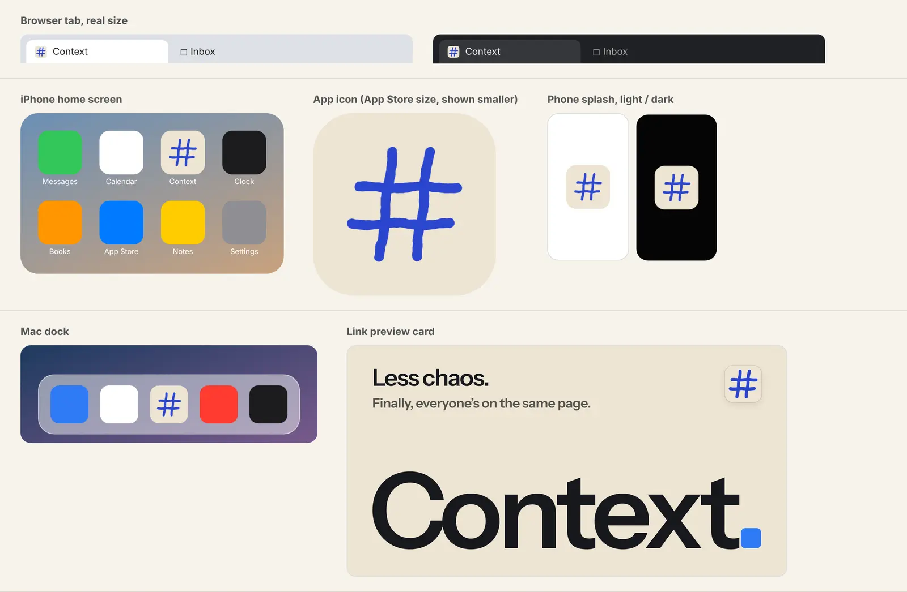
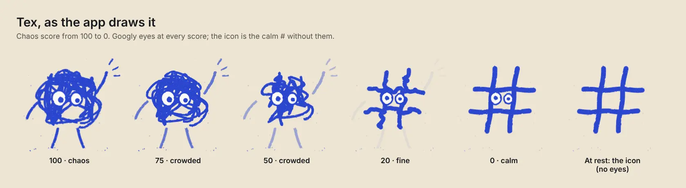
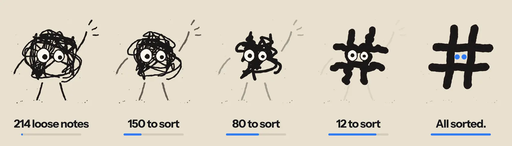
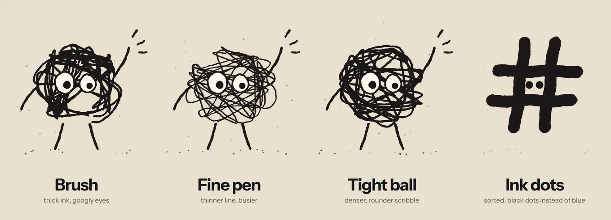
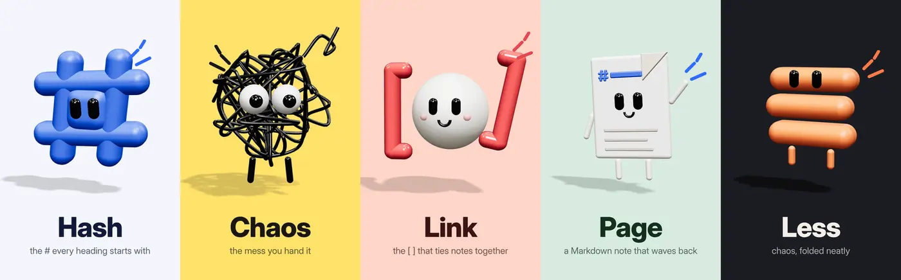
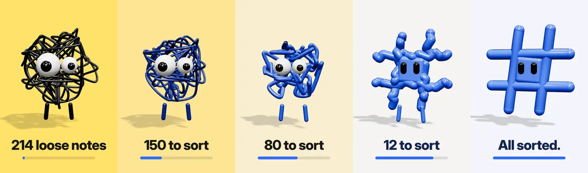
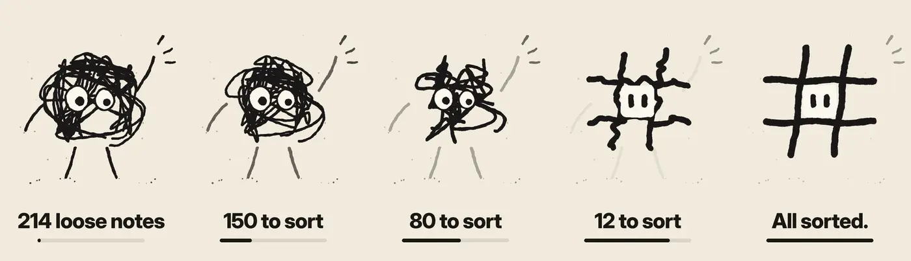
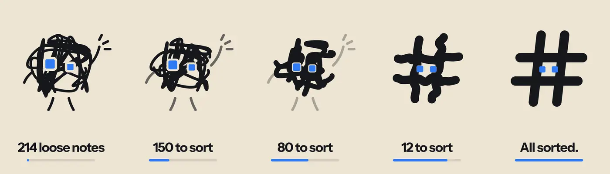
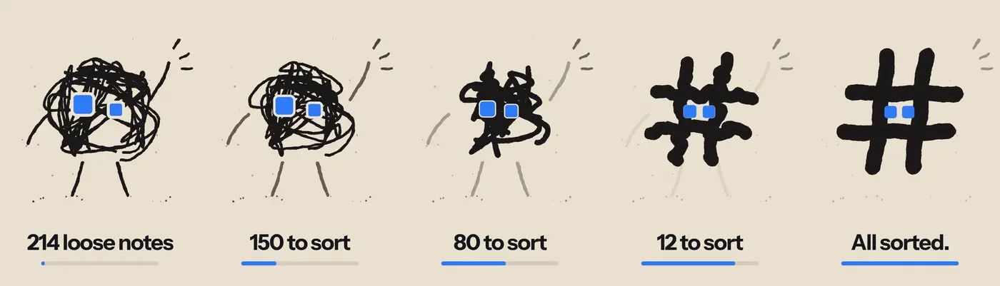
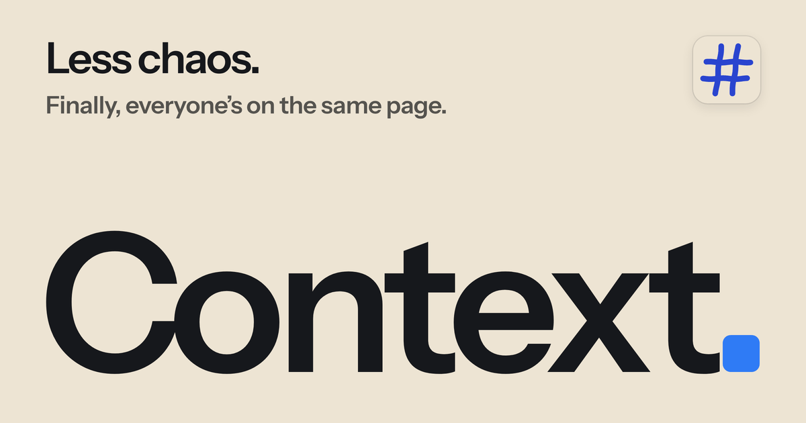

# Brand

What Context looks like, in one place: the mark, Tex, the colours and the type.
The pictures here are references. The sources that ship are in the code, linked
from each section.

## The mark

Tex at rest: the hand-drawn `#` the mascot becomes once a workspace is sorted,
with no eyes, in Tex's blue on cream paper. It is the favicon, the iOS, Android
and macOS app icons, the phone splash and the link preview card's corner tile
(owner's decision, 2026-10-12, replacing the ruled blue `#` on a black tile).

- A `#` because it is the Markdown heading marker: your context stays plain
  files you own.
- Always on paper. Never on the old black tile, never with googly eyes.
- At favicon sizes (16 to 48px) the strokes are heavier and the brush texture is
  dropped, because grain only greys ink that small.
- Source: `apps/mobile/assets/source/tex-mark.mjs` draws every icon from Tex's
  own geometry; `generate.sh` there renders them. See that folder's README.

## Tex

Tex is the mascot and the chaos score's face: a googly-eyed ink scribble that
untangles into the `#` as a workspace calms down. The app draws one Tex
everywhere, from `apps/mobile/features/chaos/figureGeometry.ts`.

- Googly eyes at every chaos score in the app. The icon is the only Tex without
  eyes.
- Ink is Tex blue on light pages, a lighter periwinkle on dark ones
  (`texColors` in `features/design/tokens/landingColors.ts`).
- Decorative: wherever Tex appears, the score is also said in words.

### The board Tex was picked from

The chosen direction (2026-10-10): flat paper ink, googly eyes that settle as
things get sorted. The app later kept the eyes on at every score and drew Tex in
blue.

### How Tex got here

Earlier rounds, kept for the record of what was tried and why it moved on.

1. Six robot mascots, turned down: the bar was soft characters with
   personality, themed on less chaos.
2. 3D clay characters (Hash, Chaos, Link, Page, Less). Chaos won.

   

3. Chaos untangling into a calm blue `#`, the idea that stuck.

   

4. Flat paper ink, which was liked but read as too close to another product's look.

   

5. Context's house style: clean even strokes and the app icon's exact `#`.

   

6. Paper ink with the blue rounded-square period as eyes. Round 7 swapped those
   for googly eyes and became the board above.

   

## Colours

| Name | Value | Where |
| --- | --- | --- |
| Paper | `#EDE4D3` | Icon ground, link preview card |
| Tex blue | `#2A45CF` | Tex and the mark on light pages |
| Ink | `#16181C` | Type on paper |
| Ink 2 | `#55534E` | Secondary type on paper |
| Period blue | `#2F7BF5` | The rounded-square period in "Context." |

The app's own palette lives in `apps/mobile/features/design/tokens.ts`.

## Type

- **Instrument Sans** (400, 500, 600): interface and the wordmark. The link
  preview card sets "Context." in 600.
- **Libron**: note text (`apps/mobile/public/libron.css`, OFL).
- **JetBrains Mono**: code.

## The link preview card

Paper ground, "Less chaos." with its line on top, the icon top right, and
"Context." set huge with the blue period. Source:
`infra/router/og-card.source.html`.

