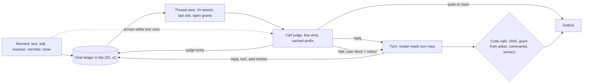

# One record per chat, one judge per moment (design, 2026-11-10)

_Part of [the texting assistant](../texting-assistant.md). Status: proposed by Dev2's design task, not built. Builds on [chat-ledger](./chat-ledger.md) and [conversation-threads](./conversation-threads.md)._

## The problem

Whether Tex answers is decided by four rule sets in series, each reading a different slice of the chat:

1. Worker regexes: `apps/agent/src/isItForTex.ts` (`ANSWERS_ASK`, gask), `groupWords.ts` (`addressesTex`, `namesTex`).
2. Clef decide and recheck, zero-shot: `apps/mcp/src/agent/textsDecide.js`, `decide.js`, `recheck.js`; Worker `decide.ts`, `groupRecheck.ts`, `lookAgain.ts`, `steer.ts`.
3. The few-shot Haiku respond classifier: `apps/mcp/src/agent/respond.js` (`RESPOND_EXAMPLES`), called from `runTheModel.js`.
4. The code floor `mayHush` in `respond.js`.

What people see:

- Someone answers Tex's question in a group without the word "Tex" and gets nothing.
- "approve" or a thumbs-up is not taken as a yes.
- Another bot's line makes Tex answer.
- A direct ask is vetoed.
- Replies take 12 to 38 s: decide, classifier, the model at effort high, and a Haiku reviewer that can send the draft back twice, one after another.
- A late text or an edit reaches the model in the same user block as harness notices. The Haiku guide says never to mix them.

Conversation state is split across the event log, the ledger, chat memory and the carried stretch rounds.

## What exists to build on (the chat ledger)

The "one versioned JSON file in the DO" is the chat ledger. It is decided in [chat-ledger](./chat-ledger.md) (2026-11-02) and built in a series of merged PRs, most recently #3110, #3111, #3144 and #3150. Where it stands on main:

- **Storage.** One append-only ledger per chat, in a Durable Object (`texStore/ledger.js`): `person:<workspaceId>` for a one-to-one chat and `chat:<groupKey>` for a group. It has a manifest and `v` on every entry, and a reader refuses a version newer than it knows. It keeps texts, thinking, tool calls, replies, advisor asks, jobs and notes.
- **Retired copies.** Event log writes stopped. The Worker's day copy was cut to an outbox. History record reads and writes were retired in #3144. Transcript writes stopped. The group memory page was retired.
- **Not started.** The Tex page's own records.
- **Still outside the ledger.** Desk `direct` keys (`keepDeskKeys`). Event-log writes for group grants that name no chat.
- **Threads.** Each text is sorted into a conversation thread before the model (#3110), and older history was backfilled (#3111).
- **Respond classifier.** #3150 lets the thread classifier answer reply, react or quiet, before the model, with the `mayHush` floor. Open #3170 writes one `classify` entry per turn with both reasons.
- **Gap.** Clef decide and the Worker regexes run before all this, on the Worker's own slice. They do not read the ledger.

So the record exists. This design makes it the only input to judging, and makes judging one step.

## Target system

**One record per chat.** The ledger stays the record, with the same place and writers (the gateway's `/agent/events` and turn writes). Three kinds are added in a new version (`v2`), so no v1 entry changes meaning:

- `judge`: the one verdict for a moment.
- `notice`: harness facts such as a late text, an edit, a reaction, a member change or a timer. Each one is its own entry, never mixed into a text.
- `grant`: a yes that may release a held send. It records who said it, to which ask, and on which entry.

Every reader reads the record through views:

- The judge reads the same thread view the model reads.
- The model reads the turn view.
- The Tex page and export read the raw view.

The Worker keeps only the outbox and the hard rails. It does not keep a second reading of the chat. The carried stretch rounds become a view: the entries of the current thread within the last hour. They are no longer a separate store.

**Trust rules, stated once on the record:**

- A `grant` may be minted only by a text from the person who was asked, in reply to an `ask` entry.
- Group chatter never mints a grant.
- A line from another bot, by sender id from the allowlist, is a `text` with `from_bot: true`. It can inform a turn but never start one.
- A turn's trust is its own ([turn-trust](./turn-trust.md)).
- Another workspace's results are withheld, as today.

**One judge per moment.** A moment is a new text, an edit, a reaction, a member change or a timer. Each moment gets one Clef call (Clef stays the judge, by Dev2's decision).

What the judge is given:

- A fixed prompt prefix, which can be cached.
- Few-shot examples from real labelled chats, with names changed. This starts from `RESPOND_EXAMPLES` and the hush cases in #3150, plus labelled misses: an unaddressed answer to Tex's question, "approve" or a thumbs-up as a yes, another bot's line, and a direct ask.
- The thread view from the ledger: the current thread within the 1 h stretch, Tex's last ask and the open grants.
- The moment itself.

What the judge returns, written as one `judge` entry:

- `act`: `reply`, `react` (with an emoji) or `quiet`.
- `thread` and `place`.
- `answers_ask`: the id of the ask, or none.
- `why`.

The Haiku respond classifier merges into this call, because the two answer the same question. Thread sorting moves into the same call as one more field. Recheck becomes the same judge called again for a moment that arrives during a running turn. It is not a second model.

Code keeps only the hard rails:

- SMS limits.
- A held send goes only on a `grant` from the asker.
- Commands, such as stop and quiet hours.
- Privacy and the grant rule above.
- A short floor: a direct question in a one-to-one, or a text that names Tex, is never quieted. This is the old `mayHush` cut to rails.

The Worker regexes `ANSWERS_ASK`, gask and `addressesTex` become examples, not rules.

**Interjections during a running turn.** Every moment is appended to the ledger first. If a turn is running for that chat, the judge sees the moment and answers `fold`, `restart` or `ignore`:

- `fold`: the turn takes it at its next model step as a new user message. The person's words go in their own user content block. The harness facts go as a separate `notice`, rendered as a system-side message, never in the same block.
- `restart`: the current draft is dropped before it is sent.
- `ignore`: the moment is recorded and the turn goes on.

An edit is recorded as a new entry that points to the original.

**Latency budget** (target: under 5 s to the first text for a simple ask):

| Step | Budget | Note |
| --- | --- | --- |
| Ledger append and thread view read | 0.2 s | One DO, in parallel with each other |
| Judge (Clef, cached prefix) | 1.0 s | Starts at once. It no longer waits for the Worker's decide or the classifier, which are deleted |
| Model | 3.0 s | Effort set by the judge: `low` for a simple ask, `high` only when the judge marks the ask `work` |
| Reviewer | 0 s on the path for simple asks | Runs only on drafts with tool results or held sends. At most 1 send-back |

The setup reads (skills, about-me) start in parallel with the judge, not after it.

## PRs (each ships something a person notices)

1. **Answers to Tex's questions are heard.** A group reply to Tex's question, "approve" or a thumbs-up is taken as an answer or a yes, with no "Tex" needed.
   - Scope: Clef `textsDecide.js` and `decide.js` get few-shot examples and Tex's last ask from the ledger. `grant` entries in `agent/ledger.js` (v2). The Worker `decide.ts` sends the moment rather than its own slice.
   - Deletes: `ANSWERS_ASK` and the gask regex in `isItForTex.ts`.
   - Known by: in a replay of the labelled misses, every answer to Tex's ask gets a reply, and a held send goes on a thumbs-up from the asker and not from anyone else.
   - Depends on: nothing. Risk: false yes. The grant rail in code still requires the asker.
2. **Tex stops answering other bots and stops vetoing direct asks.**
   - Scope: `from_bot` on texts, judge examples, the `mayHush` floor cut to rails.
   - Deletes: the `addressesTex` and `namesTex` routing in `groupWords.ts`, which stay only as a rail for "names Tex".
   - Known by: zero Tex replies to bot lines, and zero vetoed direct asks, in Tex Devs over a week.
   - Depends on: 1. Risk: allowlist gaps for bots.
3. **Replies come in under 5 s for simple asks.** The respond classifier and thread sort merge into the Clef judge (one call). The effort is set by the judge. The reviewer is off the path for simple drafts, with at most one send-back.
   - Scope: `respond.js`, `conversationThreads.js`, `runTheModel.js`, the reviewer.
   - Deletes: the separate Haiku classifier call, the serial decide-then-classify chain, and the second send-back.
   - Known by: the 50th-percentile time to first text for simple asks is under 5 s on the Tex page timings, with the measurement shipped in this PR.
   - Depends on: 1. Risk: a lower-effort reply is worse. The judge can mark `work`.
4. **A late text or an edit changes the answer Tex is writing.** Interjections enter a running turn as `fold`, `restart` or `ignore`. Notices are system-side messages, separate from the person's words.
   - Scope: Worker `groupRecheck.ts`, `lookAgain.ts`, `steer.ts` become one call to the judge. `recheck.js`, plus the turn's message builder.
   - Deletes: recheck as a separate model and prompt, and the mixed notice-plus-text blocks.
   - Known by: a correction sent within 10 s of an ask is reflected in the reply, observed in the bench and in chat.
   - Depends on: 3. Risk: restart loops. Cap at 1 restart per turn.
5. **Tex remembers the last hour of the conversation the same way in every path.** The carried stretch rounds and chat memory are read as a ledger view.
   - Scope: the stretch carry and `ledgerHistory.js` views.
   - Deletes: the carried-round store and the remaining event-log grant writes.
   - Known by: a follow-up within 1 h that refers back ("the second one") is answered correctly in a job, a group and a one-to-one.
   - Depends on: 1. Risk: the view budget. Keep the 1 h cap.
6. **The Tex page shows why Tex answered or kept quiet, for every moment.** It renders `judge` entries, and the Tex page's own records are retired into the ledger (step 5 of chat-ledger).
   - Scope: `texPage/ledger.js` and the page. This builds on #3170.
   - Deletes: the Tex page's own records.
   - Known by: Dev2 can open any reply on tex.lc/admin and read its judge `why`.
   - Depends on: 3. Risk: low.

## Owner questions

1. Should the judge also set the model's effort, which PR 3 needs to reach 5 s, or should effort stay fixed at high?
2. Should the reviewer leave the path for simple drafts with no tools and no held send, or must every texted reply be reviewed?
3. Should a thumbs-up from the asker release any held send, or only sends below a risk level (for example, not email to outsiders)?
4. Should #3170 merge as is, so PR 6 builds on its `classify` entry, or should it be folded into the `judge` entry?
