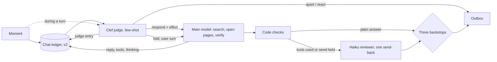

# Fewer gates, a main model that researches (design, 2026-11-11)

_Part of [the texting assistant](../texting-assistant.md). Status: PR 1 (one judge, #3174) built 2026-11-11; the rest is design. The decisions are Dev2's (2026-11-10 and 2026-11-11). Builds on [chat-ledger](./chat-ledger.md) and [conversation-threads](./conversation-threads.md)._

## The root issue

Tex spends its time and complexity on gates around the answer, and too little on the answer itself.

- **The gates.** Before the main model: word rules, a Clef judge, a Haiku thread classifier, an optional Clef router. Inside it: a Clef call after every page read that guesses the next link. After it: a Haiku reviewer that can send a draft back twice, code checks that send it back once, and a Clef recheck in the Worker. Most of these run one after another.
- **The answer.** The main model takes the first source that looks adequate. In the Instinct test it gave an npm date where the GitHub release was asked for, and said "7.0" where the release is 7.0.2. Earlier logs showed Tex failing to open web pages in group turns.
- **The measure.** The latest Instinct test scored 4 of 6. First replies took 38, 26, 14, 25, 12 and 14 s.

The fix is the inverse: one judge in front, a floor of three code backstops behind, and the main model given the tools, budget and instructions to research and verify.

## What the code does today (read 2026-11-11, branch feat/tex-one-judge)

### Research path

- **Tools.** The main model gets `search_web` (Brave, 6 results, snippets cut to 400 characters) and `open_page` (`apps/mcp/src/agent/search.js`, `computer.js`). A 1:1 text gets the person's browser; a group gets the chat's own browser and the same search (`turnWeb.js:75-82`). Both reach the model as tools (`turn.js:286`, `turn.js:295`).
- **Budgets.** Without the setup's `open_web`, a question may run 3 searches and open 5 pages (`search.js:23`, `computer.js:59`). With it, 50 and 40 (`search.js:31`, `computer.js:66`). A page shows the model at most 12,000 characters, with a cut marker that says how to read on (`computer.js:86`, `computer.js:270-283`).
- **Which pages may open.** Without `open_web`, only an address the person wrote, a search result or a link on an opened page (`computer.js:464-468`). The model cannot open a release page it knows the address of unless a search returned it.
- **Failures.** A failed page reaches the model as an error tool result with a next step: try the browser or another site (`computer.js:488-489`, `otherSites.js:45`, `providers.js:56-69`). The cause (timeout, refused, wall) is logged and not told (`computer.js:351-360`). A thrown tool error reaches the model without its reason (`turn.js:626-639`).
- **Instructions.** The built-in prompt has no rule to prefer the primary source or to give the exact figure. `RESEARCH_LINE` covers prices and options only (`prompt.js:209-218`). `DIRECT_LINE` says to answer with no tools when what is in front of Tex answers it (`prompt.js:168`). The production setup's prompt and skills replace or add to these and live in @context-lc, so their wording is not checked here.
- **Group failures.** The code offers the web to group turns. Why earlier group turns failed to open pages is not settled. The `open_page_failed` code in the gateway log tells the address guard, the page cap and the browser apart.

### Gates on a 1:1 text

1. Worker: a single text with no waiting ask skips the judge and goes straight to the gateway (`apps/agent/src/inboxTurn.ts:201`). Otherwise the Clef judge runs first.
2. Gateway, before the main model: the reads, then the Haiku thread classifier, started early and awaited just before the model (`readTheHistory.js:35`, `runTheModel.js:84`), then the Clef router when the setup names one (`turn.js:339-344`).
3. Inside the turn: a Clef link guess after each `open_page` call, while under the page cap (`computer.js:490`).
4. After the draft: the Haiku reviewer at low effort with an 8 s limit, when the setup turns it on, and up to 2 send-backs, each a full main-model round (`replyJudge.js:37-45`, `runTheModel.js:60`). Without it, code checks may send a draft back once (`runTheModel.js:70`).
5. Worker, after the reply: a Clef recheck, only when the person texted again during the turn (`lookAgain.ts`, `inbox.ts:369`).

### Gates on a group text

The same as a 1:1 text, with three differences:

- the judge always runs (`groupTurn.ts:178`);
- a group turn is streamed, so its budgets are 30 rounds and 9 minutes of tools (`progress.js:46-52`), and each progress line is reviewed by Haiku too (`runTheModel.js:75-78`);
- the Worker's recheck is `recheckDraft` (`groupModelTurn.ts:156`).

Which of the setup-dependent gates are on in production (reviewer, router, `open_web`, effort) is not verified here.

## The one record: the chat ledger

The one versioned JSON record per chat already exists. It is the chat ledger in a Durable Object (`texStore/ledger.js`; [chat-ledger](./chat-ledger.md); #3110, #3111, #3144, #3150).

- **Where it lives.** A one-to-one chat lives in `person:<workspaceId>` and a group chat in `chat:<groupKey>`.
- **How it is written.** It is append-only, with a manifest and `v` on every entry.
- **What it holds.** Texts, thinking, tool calls with their results, replies, advisor asks, jobs and notes.

This design adds no store. Every reader reads the ledger, including the judge. Two kinds are added in a `v2`: `judge` (the verdict for a moment, with its reason) and `notice` (a harness fact). No v1 entry changes meaning.

## One judge: Clef, few-shot, every moment

A moment is a new text, an edit, a reaction, a member change or a timer. It is appended to the ledger, then Clef judges it once.

- With no turn running, Clef returns `respond`, `react` (with an emoji) or `quiet`.
- With a turn running, it returns `fold`, `restart` or `ignore`.
- In both cases it also returns the thread, the effort for the main model and a `why`, written as one `judge` entry.

The leaning is taught by few-shot examples from real labelled chats, with names changed. Lean quiet or react in chatter. Lean helpful for Tex's name, a reply to Tex, or an answer to Tex's own question, including "approve" and a thumbs-up. Other bots' lines are quiet.

A text that arrives during a turn enters it as a user turn, never inside a `tool_result`.

## The main model researches and verifies

- **Instructions.** For a fact from the web, go to the primary source (the project's own release page over a package index, the venue's own page over a directory) and give the exact figure it shows (7.0.2, not 7.0). When two sources disagree, say which one the answer used.
- **Reach.** The page and search caps stop being the reason an answer stops short. A release or docs page the model can name opens without first being returned by a search, under the same address guard rules the setup's `open_web` already allows.
- **Failures it can act on.** A failed page tells the model which kind of failure it was (timed out, refused, behind a sign-in or a captcha), never plumbing details. The model then picks the next step itself.
- **No side model inside the loop.** The Clef link guess after each page read goes; the model picks its own next link.

## Safety: the prompt teaches, code backstops only what cannot be undone

Code enforces three things at the send or tool boundary, and nothing else:

1. **An irreversible send needs the asker's own yes to that exact send.** Code holds the send under an id and releases it only when a ledger entry from the asker answers that id.
2. **Private data never reaches a group.** A group turn's tool results from a personal workspace are refused at the boundary.
3. **An unverified SMS sender cannot trigger actions.** Its turn gets no action tools.

These three are what make it safe to delete the other gates.

## One layout for every model call

The judge and the main model use the same five parts, in the same order:

1. System prompt, fixed: identity, rules and each skill's name and when to use it. A skill's body loads through a tool.
2. Tools, fixed: the same full list on every call.
3. Long-lived context: custom instructions, about-me and group notes, cached.
4. Messages: the ledger as real user and assistant turns, with tool calls, results and thinking as structured blocks.
5. A per-text block just before the newest text: time, who is asking, settings and harness notices.

Parts 1 to 3 are a stable prefix, so they cache. Notices are never inside a person's words.

## Reviewer

The first draft carries most of what the reviewer catches today: a default to action, a length rule with its reason, a few examples, and thinking on tool turns. Mechanical checks move to code: a promise with no job behind it, a reply that is too long, another script's characters, sums.

One small Haiku reviewer stays, only for problems that need the ledger to see: a claim that something was done when it was not, a fact that is not in what was read, and giving up after one source. It runs only on drafts that used tools or hold a send, and sends a draft back at most once.

## Latency (target under 5 s to the first text for a simple ask)

| Step | Budget |
| --- | --- |
| Ledger append and view, in parallel with the setup reads | 0.2 s |
| Clef judge, cached prefix | 1 s |
| Main model, at the effort the judge set | 3 s |
| Reviewer | 0 s for plain answers |

A research ask takes longer, by the pages it opens. Those pages open in parallel, and nothing else waits in series around them.

## PRs

Each PR has one outcome a person notices and moves one Instinct metric: accuracy on web facts, speed to the first reply, or answering the right message. Together they cover the root issue; no two change the same thing.

1. **Tex answers the right message in a group (#3174, as is).**
   - **Changes.** One Clef judge with few-shot examples decides respond, react or quiet. The word rules, the `mayHush` floor and the Haiku respond classifier are deleted. The judge's `why` is logged with every verdict.
   - **Metric.** Answering the right message.
   - **How we know.** In Tex Devs over a week, no answer to Tex's ask goes unheard and no other bot's line gets a reply; any verdict can be traced to its `why`.
2. **Tex gives the exact fact from the source that owns it.**
   - **Changes.** The prompt rule to use the primary source and give the exact figure. A failed page tells the model which kind of failure it was. Caps and the address guard stop cutting research short. The Clef link guess inside `open_page` is deleted. The group web failure is traced from the `open_page_failed` codes and fixed.
   - **Metric.** Accuracy on web facts.
   - **How we know.** The Instinct web-fact asks (a release version and date among them) are answered with the primary source's exact figure, in a 1:1 and a group.
   - **Depends on.** Nothing.
3. **Simple asks are answered in under 5 s.**
   - **Changes.** The three backstops at the send and tool boundary. Mechanical checks move to code. The reviewer runs only on tool or held-send drafts, with one send-back. The thread classifier and the router are deleted: the judge sets the thread and the effort. The first draft is fixed (default to action, length rule, examples).
   - **Metric.** Speed to the first reply.
   - **How we know.** The median time to first text on the Instinct simple asks is under 5 s, shown on the Tex page timings, with that measurement shipped here.
   - **Depends on.** 1.
4. **A correction sent while Tex is working changes the answer.**
   - **Changes.** `fold`, `restart` and `ignore` come from the same judge, and mid-turn texts enter as user turns. `recheck.js`, `groupRecheck.ts`, `lookAgain.ts` and `steer.ts` stop being separate paths.
   - **Metric.** Answering the right message.
   - **How we know.** A correction within 10 s of an ask is reflected in the reply, in the bench and in chat.
   - **Depends on.** 1.
5. **Follow-ups are fast because the prompt prefix is cached.**
   - **Changes.** The five-part layout for the judge and the main model. The ledger rendered as real turns with structured tool and thinking blocks. Skills load on demand. The carried rounds become a ledger view.
   - **Metric.** Speed to the first reply, on follow-ups.
   - **How we know.** The cache hit rate on parts 1 to 3 is shown on the Tex page timings, and follow-up replies are faster than first replies.
   - **Depends on.** 3.

## Owner questions

1. Where do the labelled examples come from? Dev2 labelling a set from Tex Devs and customer chats, or the judge's logged `why` reviewed afterward?
2. Does "irreversible" cover calendar invites and note shares to others, or only email, posts and texts to third parties?
3. PR 2 lets the model open a page it can name without a search returning it first. Is that the same as turning on `open_web` for every setup, or should it stay per setup?
4. Is "one restart per turn" in PR 4 a limit Dev2 accepts, given that it lives in code?
