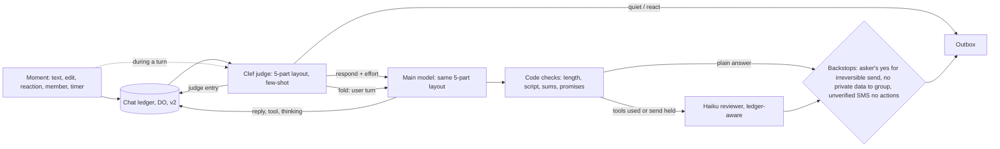

# One record per chat, one judge per moment (design, 2026-11-11)

_Part of [the texting assistant](../texting-assistant.md). Status: design. The decisions are Dev2's (2026-11-10 and 2026-11-11). None of it is built yet. Builds on [chat-ledger](./chat-ledger.md) and [conversation-threads](./conversation-threads.md)._

## The problem

Today four rule sets decide in series whether Tex answers, and each reads a different slice of the chat:

1. Worker regexes: `apps/agent/src/isItForTex.ts` (`ANSWERS_ASK`, gask), `groupWords.ts` (`addressesTex`, `namesTex`).
2. Clef decide and recheck, zero-shot: `apps/mcp/src/agent/textsDecide.js`, `decide.js`, `recheck.js`; Worker `decide.ts`, `groupRecheck.ts`, `lookAgain.ts`, `steer.ts`.
3. The few-shot Haiku respond classifier: `apps/mcp/src/agent/respond.js` (`RESPOND_EXAMPLES`), called from `runTheModel.js`.
4. The `mayHush` code floor in `respond.js`.

What people see:

- Someone answers Tex's question in a group without the word "Tex" and gets nothing.
- "approve" or a thumbs-up is not taken as a yes.
- Another bot's line makes Tex answer.
- A direct ask is vetoed.
- Replies take 12 to 38 s: decide, the classifier, the model at effort high, and a reviewer that can send a draft back twice, one after another.
- A late text arrives mixed with harness notices in one user block.
- Conversation state is split across the event log, the ledger, chat memory and the carried stretch rounds.

## The one record: the chat ledger

The one versioned JSON record per chat already exists. It is the chat ledger in a Durable Object (`texStore/ledger.js`; [chat-ledger](./chat-ledger.md); #3110, #3111, #3144, #3150).

- **Where it lives.** A one-to-one chat lives in `person:<workspaceId>` and a group chat in `chat:<groupKey>`.
- **How it is written.** It is append-only, with a manifest and `v` on every entry.
- **What it holds.** Texts, thinking, tool calls with their results, replies, advisor asks, jobs and notes.
- **Already retired into it.** The event log writes, the Worker's day copy, the history record and the transcripts.
- **Still outside it.** The Tex page's own records, desk `direct` keys, and the group grant writes that name no chat.

This design builds on the ledger rather than adding a store. It makes three changes:

- Every reader reads it, including the judge, which today reads the Worker's own slice.
- Two kinds are added in a `v2`: `judge` (the verdict for a moment, with its reason) and `notice` (a harness fact). No v1 entry changes meaning.
- The carried stretch rounds become a view of the ledger rather than a separate store.

## One judge: Clef, few-shot, every moment

**What counts as a moment.** A moment is a new text, an edit, a reaction, a member change or a timer. The moment is appended to the ledger first. Then Clef judges it, alone, once.

**What Clef returns:**

- With no turn running, `respond`, `react` (with an emoji) or `quiet`.
- With a turn running for that chat, `fold`, `restart` or `ignore`.
- In both cases, the thread, the effort for the main model (per-message effort, which Dev2 verified works through the gateway) and a `why`. All of it is written as one `judge` entry.

**How the leaning is taught.** Clef learns it from few-shot examples taken from real labelled chats, with names changed. No code holds the leaning.

- In ordinary chatter, lean quiet or react.
- Lean helpful for:
  - a direct use of Tex's name;
  - a reply to Tex;
  - an answer to Tex's own question, including "approve" and a thumbs-up.
- Lines from other bots are taught as quiet.
- The seed examples come from `RESPOND_EXAMPLES`, the hush cases in #3150 and the misses listed above.

**What is deleted.** Every behavior rail goes:

- `ANSWERS_ASK`, gask, the `groupWords.ts` routing, `addressesTex` and `namesTex`;
- the `mayHush` floor;
- the Haiku respond classifier.

The thread sort becomes a field of the judge.

**Mid-turn texts.** A text that arrives during a turn enters that turn as a user turn. It never goes inside a `tool_result`.

- `fold`: the running turn takes the text at its next step.
- `restart`: the turn drops its draft before it is sent.
- `ignore`: the text is recorded and the turn goes on.

## Safety: the prompt teaches, code backstops only what cannot be undone

The rules live in the prompt. Code enforces only three things, as checks at the send or tool boundary, with no effect on ordinary turns:

1. **An irreversible send needs the asker's own yes to that exact send.** This covers an email, a post or any other send that cannot be taken back.
   - Code holds the send under an id and releases it only when a ledger entry from the asker answers that id.
   - The judge decides which text is that answer.
   - Code checks only the sender and the id.
2. **Private data never reaches a group.** A group turn's tool results from a personal workspace are refused at the boundary.
3. **An unverified SMS sender cannot trigger actions.** Its turn gets no action tools.

Nothing else is enforced in code.

## One layout for every model call

The judge and the main model use the same five parts, in the same order:

1. **System prompt, fixed.** Identity, rules and the skills list: each skill's name and when to use it. A skill's body loads on demand through a tool.
2. **Tools, fixed.** The same full list on every call.
3. **Long-lived context.** Custom instructions, about-me and group notes. It sits after the system prompt and is cached.
4. **Messages.** The conversation from the ledger as real user and assistant turns. Tex's tool calls, results and thinking appear as structured blocks.
5. **A per-text block, just before the newest text.** Time, who is asking, settings and harness notices.

Notices are never inside a person's words.

Parts 1 to 3 are a stable prefix, so they cache.

## Reviewer

Per Anthropic guidance, most of what the reviewer catches today is fixed in the first draft:

- the Haiku 5.5 "keep working until done" text;
- `<default_to_action>`;
- an explicit length rule with its reason;
- 3 to 5 examples;
- adaptive or medium thinking on tool turns.

Mechanical checks move to code. Code checks for:

- a promise with no reminder or job behind it;
- a missing job link;
- a reply that is too long;
- characters from another script;
- sums;
- an advisor ask.

One small Haiku reviewer stays, only for problems that need the ledger to see:

- a claim that something was done when it was not;
- a fact that is not in what was read;
- giving up after one source.

It runs only on drafts that used tools or hold a send. Plain answers skip it. It may send a draft back at most once.

## Latency (target under 5 s to the first text for a simple ask)

| Step | Budget |
| --- | --- |
| Ledger append and view, in parallel with the setup reads | 0.2 s |
| Clef judge, cached prefix | 1 s |
| Main model, at the effort the judge set (low for a simple ask) | 3 s |
| Reviewer | 0 s for plain answers |

## PRs

1. **Tex hears answers to its own questions and stops talking over people.**
   - **What a person notices.** A group answer to Tex's question, "approve" or a thumbs-up gets a response. Chatter between people and other bots' lines get none.
   - **Scope.** The Clef judge reads the ledger thread view and is given few-shot examples (`textsDecide.js`, `decide.js`, Worker `decide.ts`). It writes `judge` entries.
   - **Deletes.** `ANSWERS_ASK`, gask, the `groupWords.ts` routing, `addressesTex` and `namesTex`, the `mayHush` floor, and the Haiku respond classifier in `respond.js`.
   - **How we know.** In Tex Devs over a week, no answer to Tex's ask goes unheard and no other bot's line gets a reply.
   - **Depends on.** Nothing.
   - **Risk.** Tex says more in groups. The examples are tuned from the logged judge `why`.
2. **A "yes" releases exactly the send it answers, and only from the asker.** A thumbs-up from the asker sends the held email. Nobody else's yes does.
   - **Scope.** The three backstops at the send and tool boundary.
   - **Deletes.** The other code safety checks that duplicate the prompt.
   - **How we know.** In a bench replay, a held send goes out only on the asker's yes to that id, a group never gets private data, and an unverified SMS sender takes no action.
   - **Depends on.** 1.
   - **Risk.** A missed backstop path. Each one is checked once at the boundary.
3. **Tex remembers the conversation the same way everywhere, and a late text never reads as a harness note.**
   - **Scope.** The 5-part layout for the judge and the main model. The ledger rendered as real turns with structured tool and thinking blocks. The per-text block. Skills load on demand. The stretch is a ledger view.
   - **Deletes.** The mixed notice and text user blocks, the carried-round store, and inlined skill bodies.
   - **How we know.** A follow-up within 1 h that refers back is answered correctly in a group, a one-to-one and a job. The cache hit rate on parts 1 to 3 is shown on the Tex page timings.
   - **Depends on.** 1.
   - **Risk.** Breaking the prompt cache. The prefix is byte-stable and checked with a test.
4. **Simple asks are answered in under 5 s.**
   - **Scope.** The judge sets per-message effort. The first draft is fixed (default to action, length rule, examples, thinking on tool turns). Mechanical checks move to code. The Haiku reviewer runs only on tool or held-send drafts, with at most one send-back.
   - **Deletes.** Effort fixed at high, the reviewer on plain answers, and the second send-back.
   - **How we know.** The median time to first text for simple asks is under 5 s on the Tex page timings, with that measurement shipped in this PR.
   - **Depends on.** 3.
   - **Risk.** Weaker replies at low effort. The judge can choose high.
5. **A correction sent while Tex is working changes the answer.**
   - **Scope.** `fold`, `restart` and `ignore` from the same judge. Mid-turn texts enter as user turns.
   - **Deletes.** `recheck.js`, `groupRecheck.ts`, `lookAgain.ts` and `steer.ts` as separate paths.
   - **How we know.** A correction within 10 s of an ask is reflected in the reply, in the bench and in chat.
   - **Depends on.** 3.
   - **Risk.** Restart loops. One restart per turn, enforced by the turn runner as a resource limit, not a behavior rule.
6. **Dev2 can see why Tex answered or kept quiet, for any moment.**
   - **Scope.** The Tex page renders `judge` entries. The Tex page's own records are retired into the ledger (step 5 of chat-ledger).
   - **Deletes.** The Tex page's own records.
   - **How we know.** Any reply on tex.lc/admin opens to its judge `why` and effort.
   - **Depends on.** 1.
   - **Risk.** Low.

## Owner questions

1. Should open #3170 merge as is and later be replaced by the `judge` entry, or be closed in favor of PR 1?
2. Where do the labelled examples come from? Dev2 labelling a set from Tex Devs and customer chats, or the judge's logged `why` reviewed afterward?
3. Does "irreversible" cover calendar invites and note shares to others, or only email, posts and texts to third parties?
4. Is "one restart per turn" in PR 5 a limit Dev2 accepts, given that it lives in code?
